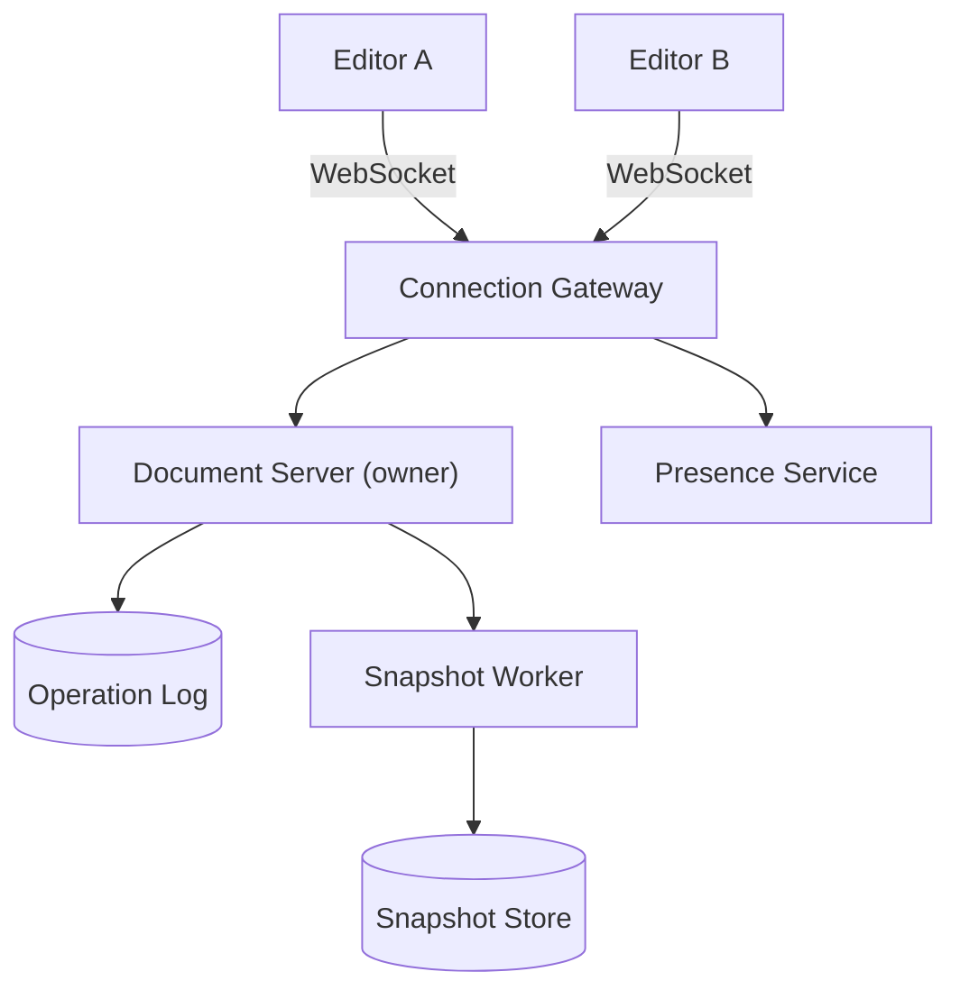
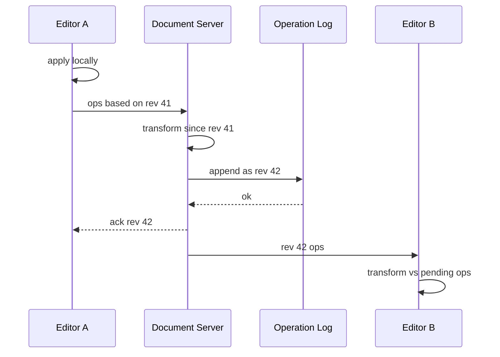

# Design Google Docs

> A collaborative document editor where many people edit the same document at once and see changes live.

This question is graded almost entirely on one problem: two people edit the same spot at the same time, and every copy of the document must end up identical. Storage and sharing are routine. The interviewer wants to hear how edits are ordered, how concurrent edits are merged, and what the server does that the clients cannot.

## 1. Requirements

**Functional**
- Create, open, and edit rich text documents.
- Many users edit one document at the same time and see each other's changes live.
- Show other editors' cursors and selections.
- Keep version history, and let users restore an earlier version.
- Edit offline and merge the changes on reconnect.

**Non-functional**
- Local typing feels instant, and remote changes appear within a few hundred milliseconds.
- All copies converge: once edits stop, every editor sees the same text.
- No accepted edit is ever lost.
- Most documents have one or two editors.

Agree out loud that each document is a small, independent unit. There are no edits that span documents, so the system can scale by giving each active document its own owner and never coordinating between documents.

## 2. Estimation

Assumptions: 5 million concurrent editors at peak, 2 editors per active document, and one batched operation per editor every 2 seconds. Each operation is 100 bytes, the daily average is 1 million operations per second, and one server handles 10,000 active documents.

- Peak operations: 5 million editors divided by 2 seconds is 2.5 million operations per second.
- Operation log growth: 1 million per second times about 86,400 seconds is 86.4 billion operations per day. At 100 bytes each, that is about 8.6 TB per day.
- Active documents: 5 million editors divided by 2 is 2.5 million documents open for editing.
- Document servers: 2.5 million documents divided by 10,000 is 250 servers at peak.

See the [estimation cheat sheet](../cheat-sheets/estimation.md) for the reference numbers.

The total load is large, but each document sees only about one operation per second (2 editors, each sending one batch every 2 seconds). That is the key fact: one server can own a document and order its edits without becoming a bottleneck. The 8.6 TB per day of operations forces regular snapshots, so opening a document never means replaying its whole history.

## 3. API

- `POST /docs` with `{ title }` returns `{ docId }`.
- `GET /docs/{docId}` returns `{ snapshot, revision }`, the latest saved content and its revision number.
- WebSocket `/docs/{docId}/edit`: the client sends `{ baseRevision, ops }` and receives `{ ack, revision }` for its own operations and `{ revision, ops, author }` for others'.
- `GET /docs/{docId}/history?before={revision}` returns version history entries.
- `PUT /docs/{docId}/permissions` with `{ userId, role }` sets viewer, commenter, or editor access.

## 4. Data model

```
documents     key: doc_id
  doc_id | title | owner_id | latest_revision | snapshot_revision

operations    partition key: doc_id, clustering: revision
  doc_id | revision | author_id | ops | created_at

snapshots     key: doc_id + revision
  doc_id | revision | content (blob)

permissions   key: doc_id + user_id
  doc_id | user_id | role
```

The operation log is the source of truth, and the snapshot is a cached result of applying it. This is [event sourcing](../patterns/event-sourcing-cqrs.md): state is rebuilt from an ordered log of changes. The hot access pattern is "append the next revision for document D" and "read revisions after N for document D", so the log is partitioned by `doc_id` and clustered by revision.

## 5. Merging concurrent edits

Edits are sent as operations, like "insert 's' at position 3". The problem is that positions change when someone else edits first.

Take the text "cat". Bob deletes the character at position 0, giving "at". At the same moment, Alice inserts "s" at position 3, meaning "cats". If Alice's operation is applied unchanged after Bob's, position 3 does not exist in "at". The fix is to transform Alice's insert against Bob's delete: one character before her position was removed, so her insert moves to position 2. Both copies become "ats".

There are two families of solutions:

| Approach | How | Trade-off |
|----------|-----|-----------|
| Operational transformation (OT) | A central server orders operations and transforms each one against the concurrent operations it missed | Simple data model and small operations, but needs a server to define the order |
| CRDT (conflict-free replicated data type) | Each character gets a unique, ordered id, so operations merge in any order without a server | Works peer to peer and offline, but ids add memory and deleted characters leave markers |

Google has described Docs as using OT with a central server, and that is the common interview answer. The server holds a revision counter per document. A client sends its operation with the revision it was based on. The server transforms it against every operation committed since that revision, assigns the next revision, appends it to the log, and broadcasts it.

Clients keep at most one batch of operations in flight. New local edits wait in a buffer until the server acknowledges the batch, which keeps transformation on both sides simple. CRDTs are the stronger answer when the product is offline-first or has no central server. See [logical clocks](../patterns/logical-clocks.md) for how CRDT ids are ordered.

## 6. High-level design



Every edit for a document goes to the one document server that owns it. Ownership is assigned with [consistent hashing](../patterns/consistent-hashing.md) on `doc_id`, so gateways can route without a lookup. A snapshot worker periodically applies the log to the last snapshot, for example every few hundred revisions. Cursor positions go to a separate presence service because they change constantly and are never saved.

The edit path, with one concurrent editor:



Editor A sees the change immediately, because it applies the operation locally first. The server acknowledges only after the log write succeeds, so an acknowledged edit is never lost. Editor B transforms the incoming operation against its own unacknowledged edits before applying it.

## 7. Bottlenecks and trade-offs

- One owner per document: a single sequencer is simple and fast for a few operations per second. See [sharding and partitioning](../patterns/sharding-partitioning.md).
- Owner failure: a replacement server takes over the document. See [leader election](../patterns/leader-election.md).
- Durability before acknowledgment: append to the log first, like a [write-ahead log](../patterns/write-ahead-log.md).
- Live updates: one WebSocket per editor. See [long polling, WebSockets and SSE](../patterns/long-polling-websockets-sse.md).

The common follow-up is why you need a central server at all. OT needs one agreed order of operations, and a single owner per document provides it cheaply. Each document is independent, so this central point never limits the whole system. See [strong vs eventual consistency](../cheat-sheets/strong-vs-eventual-consistency.md).

## The deep dives to expect

**What happens when the document server crashes?** Another server becomes the owner, loads the latest snapshot, and replays the log after it. Clients reconnect and resend unacknowledged operations with their base revision. The new owner transforms them as usual, so nothing is lost.

**How do offline edits merge?** The client keeps its operations locally with the last revision it saw. On reconnect it sends them as one batch, and the server transforms them against everything committed since. Long offline sessions can produce surprising merges, which is one reason offline-first products often choose CRDTs.

**How does version history work?** Every revision is already in the log. Named versions are pointers to a revision, and restoring creates a new operation that changes the text back, so history is never rewritten.

**How many editors can one document handle?** Each edit must be transformed and broadcast to everyone, so cost grows with editors per document. Google's help pages state that up to 100 people with view, edit or comment access can work in one document at the same time. Beyond that, only the owner and some editors can keep editing.

**Why not lock paragraphs instead?** Locks remove the merge problem but feel slow, since two people often edit near each other. Transformation lets both edits proceed, and conflicts at the same spot are rare enough that any merged result is acceptable.

## Related pages

- The same concurrency problem on a drawing canvas: [design a collaborative whiteboard](design-collaborative-whiteboard.md).
- Syncing whole files rather than individual edits: [design Dropbox](design-dropbox.md).
- Pushing live events to many connected clients: [design Discord](design-discord.md).

## Go deeper

- Quick, focused prep: [System Design Interview Crash Course](https://www.designgurus.io/course/system-design-interview-crash-course?utm_source=github&utm_medium=repo&utm_campaign=grokking-system-design&utm_content=questions-design-google-docs)
- Full course: [Grokking the System Design Interview](https://www.designgurus.io/course/grokking-the-system-design-interview?utm_source=github&utm_medium=repo&utm_campaign=grokking-system-design&utm_content=questions-design-google-docs)