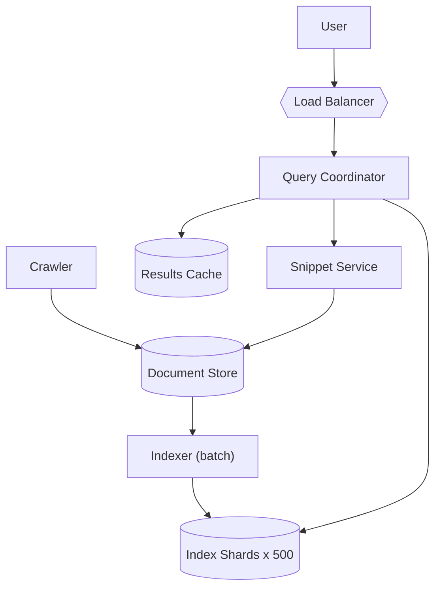
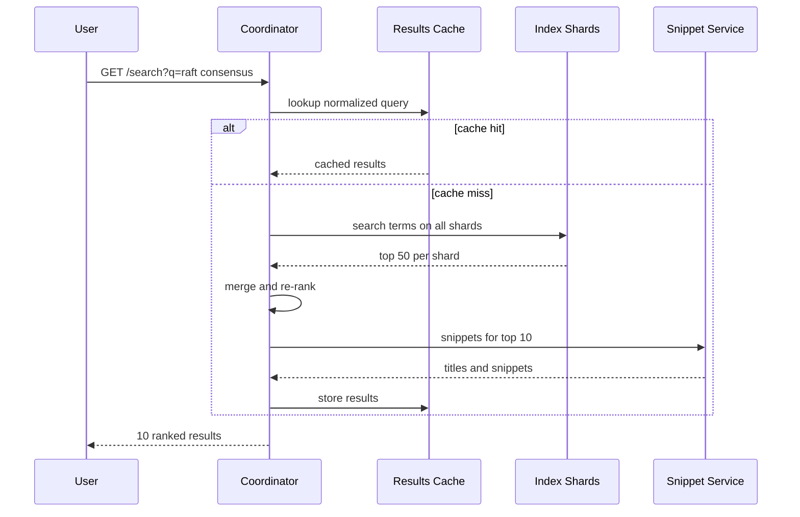

# Design Google Search

> Crawl the web, build an index, and return ranked results for a query within milliseconds.

This question has three systems inside it, and the interviewer wants to see that you know which one to spend time on. Crawling and indexing are batch problems with loose deadlines. Serving a query is a latency problem with a budget of a few hundred milliseconds. Most of the grade comes from how you split the index, how a query reaches every part of it, and how ranking stays fast.

## 1. Requirements

**Functional**
- Crawl web pages and refresh them on a schedule.
- Build an index that maps words to the pages that contain them.
- Given a text query, return the 10 most relevant pages with titles and snippets.
- Optional: spelling correction and query suggestions.

**Non-functional**
- Low latency: results in a few hundred milliseconds at p99 (the latency that 99 percent of queries beat).
- High availability: search must answer even when some machines are down.
- Index freshness of days for most pages and minutes for fast-changing sites.
- A slightly incomplete answer is acceptable, but a slow or failed answer is not.

Agree on that last point out loud before you design, because it lets the query path skip a slow shard and still return good results. Also agree that the crawler is a separate question and only an input here.

## 2. Estimation

Assumptions (all labeled as such):
- 5 billion queries per day.
- 50 billion pages in the index, with about 10 KB of useful text per page after stripping HTML.
- The full corpus is re-crawled every 30 days.

Computed numbers:
- Average queries: 5 billion / 86,400 seconds is about 58,000 per second. Assume peak is 2 times average, so about 116,000 per second.
- Raw text: 50 billion x 10 KB is 500 TB.
- Index size: a compressed inverted index is often about a quarter of the text, so about 125 TB.
- Shards: at 250 GB of index per machine, 125 TB / 250 GB is 500 shards.
- Replicas: if one machine answers 1,000 queries per second, peak load needs about 116 copies of each shard. That is 500 x 116, or about 58,000 serving machines.
- Crawl rate: 50 billion pages / 2.6 million seconds in 30 days is about 19,000 pages per second.

See the [estimation cheat sheet](../cheat-sheets/estimation.md) for the reference numbers.

These numbers rule out any single machine holding the index, so sharding is required from the start. They also show that every query touches hundreds of shards, so tail latency (the slowest few responses) decides the user's wait. Finally, replica count is driven by query load, not by storage, which is why caching popular queries saves real hardware.

## 3. API

- `GET /search?q={query}&page={n}` returns `{ results: [{ url, title, snippet }], nextPage }`.
- Internal: `POST /shard/search` with `{ terms, topK }` returns `{ docs: [{ docId, score }] }` from one shard.

## 4. Data model

```
posting_list:  term -> [ (doc_id, term_freq, positions[]) ... ]   sorted by doc_id
document:      doc_id (PK) | url | title | text | page_rank | crawled_at
term_stats:    term (PK) | doc_count
```

The access pattern is "give me every document that contains these terms," which is the reverse of how pages are stored. An inverted index (a map from each word to the list of documents containing it) answers that with one read per term. See [database indexing](../patterns/database-indexing.md). The posting lists are immutable files built in batches, so a write-optimized store is unnecessary on the serving side. The document store is a key-value lookup by `doc_id`, used only for the final 10 results.

## 5. Building and querying the inverted index

The first decision is how to split the index across 500 shards.

| Approach | How | Trade-off |
|----------|-----|-----------|
| Document-partitioned | Each shard holds a full index for its own subset of pages | Every query goes to every shard, but each shard works alone and a lost shard only removes some results |
| Term-partitioned | Each shard holds complete posting lists for a subset of words | A query touches only a few shards, but multi-word queries must move large lists between machines |

Document partitioning is the common choice, and Google's published architecture papers describe splitting the index by document. It keeps each shard independent, which matches the "partial answer is fine" requirement. See [sharding and partitioning](../patterns/sharding-partitioning.md).

Building the index is a batch job. Crawled pages are parsed into terms, grouped by term, and sorted by `doc_id` into posting lists. This is the classic [MapReduce](../deep-dives/mapreduce-batch-processing.md) job: the map step emits (term, doc_id) pairs and the reduce step writes each list. New index files replace old ones per shard, so serving machines never see a half-built index.

Ranking runs in two phases to stay inside the budget. Each shard intersects the posting lists for the query terms and scores matches with a cheap formula like BM25 (a standard score based on term frequency and how rare each term is). It returns its top 50 or so. The coordinator merges those lists and applies a more expensive model, using signals like link authority, to the few thousand survivors.

## 6. High-level design



The crawler and indexer run offline and produce index files. The coordinator and everything below it form the serving path, which reads only from those files and the document store. A slow index build therefore never slows a query.



The coordinator sends the query to one replica of each shard at the same time and sets a deadline. Shards that miss the deadline are skipped, which trades a little recall for a predictable wait. Snippets are generated only for the final 10 pages because they need the page text.

## 7. Bottlenecks and trade-offs

- Query load: add replicas per shard and spread requests across them. See [replication](../patterns/replication.md) and [load balancing](../patterns/load-balancing.md).
- Popular queries: cache full result pages keyed by the normalized query. See [caching](../patterns/caching.md).
- Duplicate URLs in the crawl: test seen URLs with a [Bloom filter](../patterns/bloom-filters.md) before fetching.

The most common follow-up is tail latency. With 500 shards, even a 1 in 1,000 chance of a slow shard means many queries wait on at least one. The answer is to send a second copy of the request to another replica if the first has not replied within a short delay, and to drop shards that miss the deadline. Both choices trade a little extra work or recall for a steady response time.

## The deep dives to expect

**How do you handle a multi-word query efficiently?** Intersect posting lists starting with the rarest term, because its list is shortest. Lists sorted by `doc_id` allow skip pointers, which jump ahead in long lists instead of scanning every entry. Phrase queries then check the stored positions.

**How does a new page get into the index quickly?** The batch index rebuilds over hours or days, so a separate small index takes recently crawled pages. The coordinator queries both and merges them like any other shards. See [batch vs stream processing](../patterns/batch-vs-stream-processing.md).

**What is in the results cache, and when does it go stale?** It stores the final ranked list per normalized query for a few minutes. Query popularity is heavily skewed, so a modest cache absorbs a large share of traffic. Newsworthy queries expire sooner.

**How do you rank results?** Start with a text score per shard, then combine it with link-based authority like PageRank, which scores a page by the pages linking to it. Click data and freshness add more signals, and the expensive model runs only on the merged top candidates.

**What happens when a whole data center fails?** Each data center holds a full copy of the index, and global load balancing sends users to the next nearest one. The index is read-only between builds, so copies never coordinate on writes.

## Related pages

- The input to this system: [design a web crawler](design-web-crawler.md).
- Suggestions while the user types: [design typeahead / autocomplete](design-typeahead-autocomplete.md).
- How a single-cluster search engine stores its index: [Elasticsearch and Lucene](../deep-dives/elasticsearch-lucene.md).

## Go deeper

- Quick, focused prep: [System Design Interview Crash Course](https://www.designgurus.io/course/system-design-interview-crash-course?utm_source=github&utm_medium=repo&utm_campaign=grokking-system-design&utm_content=questions-design-google-search)
- Full course: [Grokking the System Design Interview](https://www.designgurus.io/course/grokking-the-system-design-interview?utm_source=github&utm_medium=repo&utm_campaign=grokking-system-design&utm_content=questions-design-google-search)
