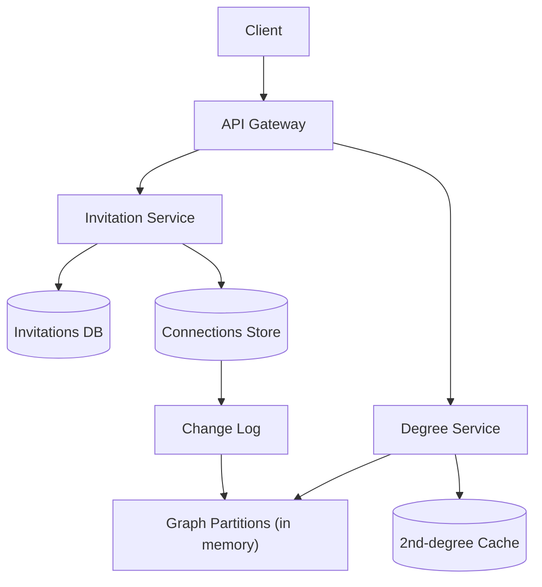
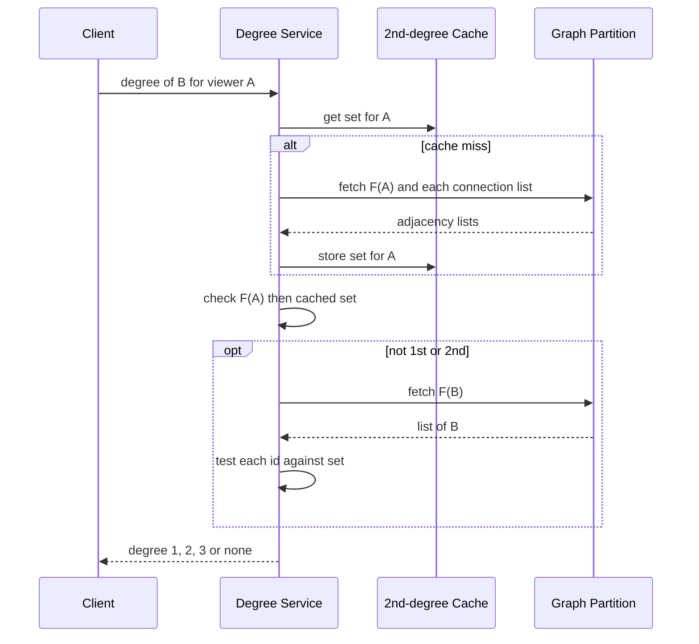

# Design LinkedIn connections

> A professional social graph with connection requests, degrees of connection, and the people graph.

This question looks like a CRUD service for friend requests, but the grade comes from the graph queries. The interviewer wants to see how you compute "how is this person related to me?" for every profile, at hundreds of thousands of lookups per second.

## 1. Requirements

**Functional**
- Send, accept, decline, and withdraw connection requests.
- Remove an existing connection.
- Show the degree of connection (1st, 2nd, 3rd, or outside the network) on every profile and search result.
- Show mutual connections between the viewer and another member.

**Non-functional**
- Low latency degree lookups (a few milliseconds), since almost every page shows them.
- High availability for reads. A missing degree badge is acceptable, a failed profile page is not.
- A new connection should appear in the two members' own degree results within seconds. Other members may see the new path hours later.

Agree on two points out loud before designing. Connections are mutual, so the graph is undirected and each accept creates one edge. And 3rd degree is the outer limit, which keeps every query bounded at three hops.

## 2. Estimation

Assumptions: 1 billion members, an average of 300 connections each, 200 million daily active members, and 50 degree lookups per active member per day (profile views plus search results).

- Edges: 1 billion times 300, divided by 2 because each edge has two ends, is 150 billion edges.
- Adjacency entries: each edge is stored in both members' lists, so 300 billion entries.
- Memory: at 8 bytes per id, 300 billion entries is 2.4 TB. With timestamps and overhead, budget about 5 TB.
- Degree lookups: 200 million times 50 is 10 billion per day. Divided by about 86,400 seconds, that is roughly 116,000 per second, and about 230,000 per second at a peak of twice the average.
- Neighborhood size: 300 connections with 300 each gives up to 90,000 people at 2nd degree, and up to 27 million at 3rd degree.

See the [estimation cheat sheet](../cheat-sheets/estimation.md) for the reference numbers.

Five terabytes of adjacency fits in memory across a few dozen machines, so the graph is served from RAM. A 2nd-degree set of tens of thousands of ids is small enough to precompute and cache per member. A 3rd-degree set of millions is not, so 3rd degree must be computed by meeting in the middle rather than by storing it.

## 3. API

- `POST /invitations` with `{ toMemberId, message? }` returns `{ invitationId, status: "pending" }`.
- `POST /invitations/{id}/accept` returns `{ connectedAt }`, with matching `decline` and `withdraw` calls.
- `DELETE /connections/{memberId}` removes the edge for both members.
- `GET /degree?viewer={a}&targets={b1,b2,...}` returns `{ b1: 1, b2: 3, ... }`. One search page shows ten or more people, so the call is batched.
- `GET /mutual?viewer={a}&target={b}&limit=10` returns `{ count, sample: [memberId, ...] }`.

## 4. Data model

```
invitations
  invitation_id (PK) | from_id | to_id | status | message | created_at
  index on (to_id, status) for the "pending invitations" page

connections  (source of truth, partitioned by member_id)
  member_id (partition key) | other_id (sort key) | connected_at

graph partition  (in memory, built from connections)
  member_id -> sorted array of other_id
```

The access pattern is "all connections of member X", always by one member id, so the source of truth is a wide-column store partitioned by `member_id`. Each edge is written once under each member, so either list is one partition read. Sorted arrays make intersection a fast linear merge. See [sharding and partitioning](../patterns/sharding-partitioning.md).

## 5. Computing degrees and mutual connections

All three degrees reduce to set operations on adjacency lists. Write F(x) for the set of x's direct connections.

- 1st degree: B is in F(A).
- 2nd degree: F(A) and F(B) intersect. The intersection is also the mutual connections list.
- 3rd degree: some member of F(B) is in A's 2nd-degree set.

How much should you compute ahead of time?

| Approach | How | Trade-off |
|----------|-----|-----------|
| Live breadth-first search | Expand A's network hop by hop until B is found | Simple, but three hops can touch millions of nodes across every partition |
| Bidirectional search | Expand one hop from A and one or two from B, then intersect | Touches far fewer nodes, but still needs a remote call per partition |
| Cached 2nd-degree set | Precompute A's 2nd-degree set when A is active, then check F(B) against it | Each lookup is one partition read plus a membership test, at the cost of cache memory and staleness |

The common design combines the last two. At session start, the degree service builds the viewer's 2nd-degree set by fetching F(A) and then the list of each connection, in parallel. It caches the result as a compressed bitmap with a TTL (time to live, the period after which it expires) of a few hours.

A lookup for B is then cheap. If B is in F(A), answer 1. If B is in the cached set, answer 2. Otherwise fetch F(B) and test each id against the cached set, stopping at the first hit, which means 3rd degree.

For a member with a very large network, store a truncated set and accept that a few 3rd-degree answers show as "outside the network".

## 6. High-level design



The invitation service creates the two connection rows on accept. A change log (an ordered stream of edge changes) feeds the in-memory graph partitions, which catch up within seconds. The degree service answers lookups from the graph partitions and the 2nd-degree cache.

The degree lookup is the hot path:



The expensive step, building the set, happens once per session. One viewer makes many lookups per session, so the hit rate is high even with a short TTL.

## 7. Bottlenecks and trade-offs

- Graph size and cross-partition reads: partition by member id and keep partitions in memory. See [sharding and partitioning](../patterns/sharding-partitioning.md) and [sharding strategies](../cheat-sheets/sharding-strategies.md).
- Repeated 2nd-degree work: cache the set per active member. See [caching](../patterns/caching.md).
- Read volume and availability: keep several copies of each graph partition. See [replication](../patterns/replication.md).
- Symmetric edges: write both rows from one change event and make the consumer [idempotent](../patterns/idempotency.md), meaning a repeated event has no extra effect. The [outbox pattern](../patterns/outbox-pattern.md) keeps the database write and the event together.

The common follow-up is freshness. A degree badge is a display hint, not a permission check, so eventual consistency is the right choice. A new edge between A and B changes the cached set of every connection of either member, about 600 entries. It is cheaper to invalidate only the two members' entries and let the others expire. See [consistency models](../patterns/consistency-models.md).

## The deep dives to expect

**How do you keep the edge symmetric if one write fails?** Treat the accept as one event carrying both member ids. The consumer writes both rows and retries until both exist, and a repeated event rewrites the same rows.

**What about accounts with millions of followers?** Model following as a separate, directed relation that does not count toward degrees, and cap connections. LinkedIn publicly limits members to 30,000 connections, which is this kind of bound.

**How do you show "50 mutual connections" quickly?** Intersect the two sorted arrays. On a list page, an approximate count from a sketch (a small summary that estimates set overlap) is enough, and the exact list is computed when opened.

**Why not use a graph database?** You can. The queries here are fixed and shallow, so a custom in-memory adjacency service is simpler and more predictable in latency. A graph database helps when queries are ad hoc or deeper than three hops.

**How does removal work?** Delete both rows, emit a removal event, and invalidate both members' caches. Other cached sets may show the old path for a few hours, which is acceptable for a badge.

## Related pages

- Ranking two-hop candidates as suggestions: [design People You May Know](design-people-you-may-know.md).
- Another read-heavy social graph: [design Twitter](design-twitter.md).
- A store that fits partitioned adjacency lists: [Cassandra deep dive](../deep-dives/cassandra-wide-column-db.md).

## Go deeper

- Quick, focused prep: [System Design Interview Crash Course](https://www.designgurus.io/course/system-design-interview-crash-course?utm_source=github&utm_medium=repo&utm_campaign=grokking-system-design&utm_content=questions-design-linkedin-connections)
- Full course: [Grokking the System Design Interview](https://www.designgurus.io/course/grokking-the-system-design-interview?utm_source=github&utm_medium=repo&utm_campaign=grokking-system-design&utm_content=questions-design-linkedin-connections)