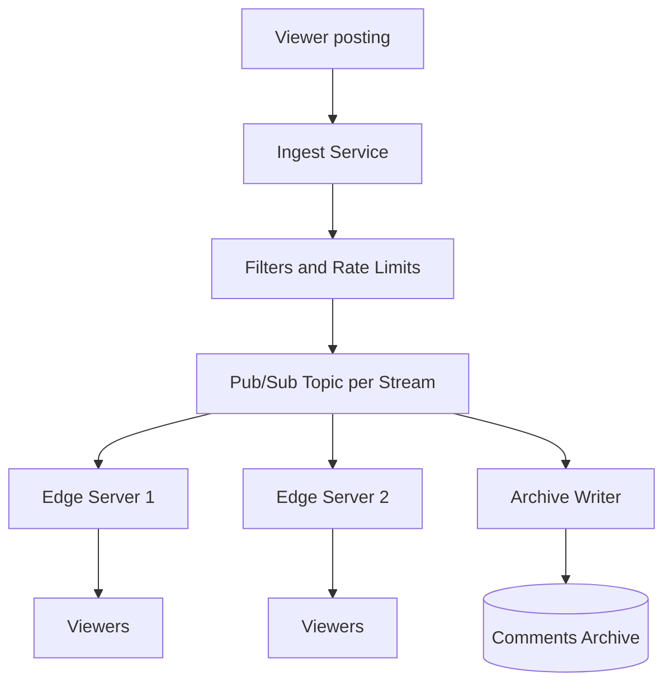
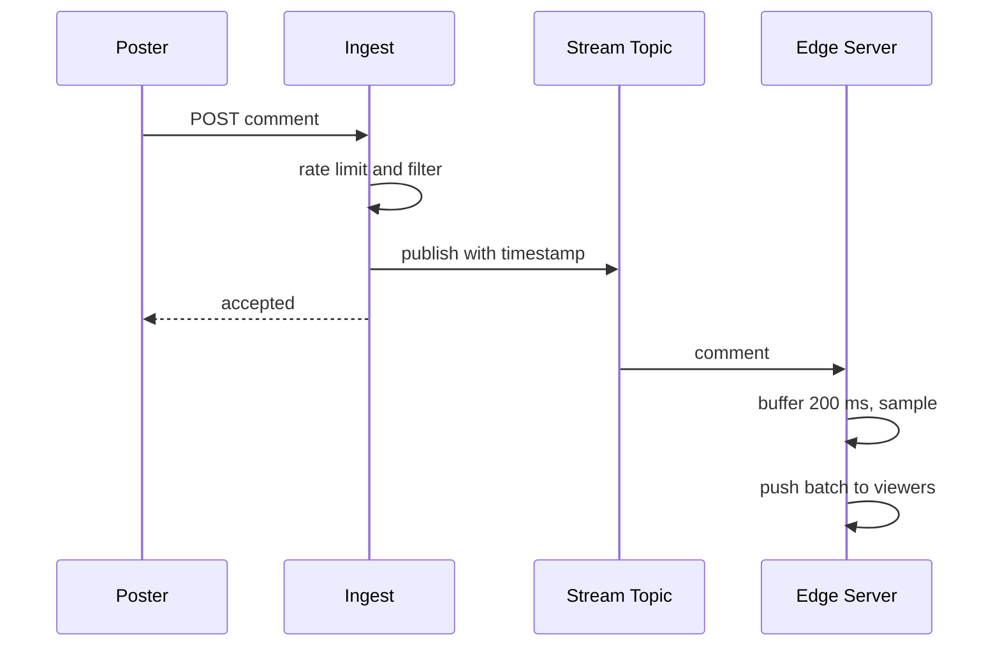

# Design a live comment streaming service (Twitch chat)

> Broadcast a high-volume stream of live comments to many concurrent viewers in real time.

This question is graded on fan-out math and on knowing what you are allowed to drop. A popular stream can have a million viewers and thousands of comments per second, which no system should deliver in full. The interviewer wants to see a two-tier broadcast layer and a clear rule for which comments each viewer actually receives.

## 1. Requirements

**Functional**
- Viewers post short text comments on a live stream.
- Every viewer of that stream sees new comments within about a second.
- Moderators and automatic filters can remove a comment, and removal reaches viewers too.
- Comments are saved so they can replay alongside the recorded video.

**Non-functional**
- End-to-end latency under about one second.
- Handle a single stream with a million concurrent viewers.
- Delivery is best effort: missing a few comments in a busy stream is acceptable.
- A slow viewer must not slow down anyone else.

Agree out loud that chat is not a messaging product. Nobody expects a guarantee that every viewer saw every comment, and that permission to drop is what makes the largest streams possible.

## 2. Estimation

Assumptions: 5 million concurrent viewers across all streams, one top stream with 1 million viewers, 1,000 comments per second in that stream at peak, 150 bytes per comment, and 50,000 connections per edge server.

- Naive fan-out for the top stream: 1,000 comments times 1 million viewers is 1 billion deliveries per second.
- Readable rate: a person reads only a few comments per second, so a cap of 20 per viewer still looks busy. That gives 20 times 1 million, or 20 million deliveries per second.
- Bandwidth for the top stream: 20 comments times 150 bytes is 3 KB per second per viewer. Times 1 million viewers, that is 3 GB per second, or 24 Gbps.
- Edge servers: 5 million connections divided by 50,000 is 100 servers in total, with 20 of them serving the top stream.

See the [estimation cheat sheet](../cheat-sheets/estimation.md) for the reference numbers.

The first number rules out full delivery. One billion deliveries per second is both too expensive and useless, since nobody can read a thousand comments a second. Capping the rate per viewer cuts the load by fifty times. The 24 Gbps figure shows why one stream must span many edge servers.

## 3. API

- `POST /streams/{streamId}/comments` with `{ text, clientId }` returns `{ commentId, accepted }`. A comment rejected by rate limits or filters returns `accepted: false`.
- `DELETE /streams/{streamId}/comments/{commentId}` (moderators only) returns `204` and broadcasts a removal event.
- WebSocket `/streams/{streamId}/live` pushes batches like `{ comments: [...], removed: [...] }` a few times per second. See [WebSockets vs SSE vs long polling](../cheat-sheets/websockets-vs-sse-vs-long-polling.md).
- `GET /videos/{videoId}/comments?fromOffset={seconds}` returns saved comments for replay.

## 4. Data model

```
comment  (in flight on the pub/sub topic for the stream)
  comment_id | stream_id | user_id | text | badges | server_ts

comments_archive   partition key: (stream_id, hour)
  stream_id | hour | stream_offset_ms (clustering) | comment_id | user_id | text | removed

user_limits   (in memory, key: stream_id + user_id)
  last_post_ts | tokens_left
```

The live path never reads from a database. Comments move through a pub/sub topic (a channel that delivers each published message to all current subscribers) and are pushed to viewers. The archive is written asynchronously and read only for replay, as a time range within one stream. That pattern fits a wide-column store partitioned by stream and hour, clustered by offset into the video.

## 5. Broadcasting comments to many viewers

Fan-out (delivering one message to many recipients) is the core problem. The options differ in how many hops a comment takes:

| Approach | How | Trade-off |
|----------|-----|-----------|
| Direct push | The ingest server sends each comment to every viewer connection | Fine for a hundred viewers, impossible for a million |
| Pub/sub plus edge servers | Ingest publishes once per stream, edge servers subscribe and push to local sockets | One publish per comment, and each edge server handles tens of thousands of sockets |
| Relay tree | Edge servers receive from regional relays, which receive from the stream topic | Keeps the topic's subscriber count small for the largest streams, at the cost of an extra hop |

Pub/sub plus edge servers is the base design, and a relay tier is added when one stream needs hundreds of edge servers. Viewers of a stream are routed to a limited set of edge servers, so each server subscribes to as few stream topics as possible. See [consistent hashing](../patterns/consistent-hashing.md).

**Sampling at the edge.** Each edge server buffers incoming comments for a short window, like 200 ms. At the end of the window it sends one batch to each viewer. If the buffer holds more than the per-viewer cap, it keeps a sample, with priority for comments from the broadcaster, moderators, and paid highlights. Batching also turns 20 small socket writes per second into five.

**Limiting at ingest.** Sampling controls what viewers receive, and rate limits control what enters. Each user gets a small token budget per stream, like one comment every few seconds. The broadcaster can turn on a slow mode that tightens it. See [rate limiting](../patterns/rate-limiting.md).

## 6. High-level design



The ingest service applies filters and rate limits before anything is published, so a rejected comment costs one request. The topic carries each accepted comment once. Edge servers do the expensive work of pushing to sockets, and the archive writer stores comments in the background.

The hot path, from post to screen:



The poster gets an acknowledgment as soon as the comment is published, and their own client shows it at once. The 200 ms buffer adds a small, fixed delay and keeps the total well under a second.

## 7. Bottlenecks and trade-offs

- Persistent connections at scale: WebSocket edge servers behind a [load balancer](../patterns/load-balancing.md). See [long polling, WebSockets and SSE](../patterns/long-polling-websockets-sse.md).
- Slow viewers: each connection has a small outbound queue, and older batches are dropped when it is full. This handles [backpressure](../patterns/backpressure.md) (a consumer that cannot keep up with its producer) by dropping old data.
- Decoupling ingest from archive writes: a [message queue](../patterns/message-queues.md) or log between them. See the [Kafka deep dive](../deep-dives/kafka-distributed-messaging.md).
- Spam: per-user [rate limiting](../patterns/rate-limiting.md) at ingest.

The common follow-up is ordering. Comments get a server timestamp at ingest, and edge servers sort each batch by it. Two viewers may see slightly different samples, and a comment can arrive a batch late. Strict global order would need a single sequencer per stream and gives the viewer nothing they would notice, so approximate order is the right choice.

## The deep dives to expect

**How does a moderator removal reach viewers who already saw the comment?** Publish a removal event on the same stream topic. Edge servers include it in the next batch, and clients hide the comment. The archive marks it removed so replay never shows it.

**What happens when an edge server dies?** Its viewers reconnect through the load balancer to another server, which subscribes to their stream if it has not already. They miss a second or two of comments, which the requirements allow.

**How do you handle a sudden spike, like a raid?** A raid is one streamer sending their audience to another stream, for example 200,000 viewers at once. New connections spread across edge servers, and new servers subscribe to the topic. Ingest rate limits keep the comment rate bounded, and sampling keeps per-viewer delivery fixed.

**How do you replay comments with the recorded video?** The archive stores each comment with its offset from the stream start. The replay player requests a window of offsets, like the next 30 seconds, and shows each comment at its time.

**How are paid highlights handled?** They take a separate path with stronger guarantees. Payment is confirmed first, then the comment is published with a priority flag that sampling never drops. See [idempotency](../patterns/idempotency.md) for not charging twice on a retry.

## Related pages

- Chat with stored history and stronger delivery rules: [design Discord](design-discord.md).
- Counting reactions on a very hot item: [design a YouTube likes counter](design-youtube-likes-counter.md).
- The live video itself: [design YouTube](design-youtube.md).

## Go deeper

- Quick, focused prep: [System Design Interview Crash Course](https://www.designgurus.io/course/system-design-interview-crash-course?utm_source=github&utm_medium=repo&utm_campaign=grokking-system-design&utm_content=questions-design-live-comment-streaming)
- Full course: [Grokking the System Design Interview](https://www.designgurus.io/course/grokking-the-system-design-interview?utm_source=github&utm_medium=repo&utm_campaign=grokking-system-design&utm_content=questions-design-live-comment-streaming)