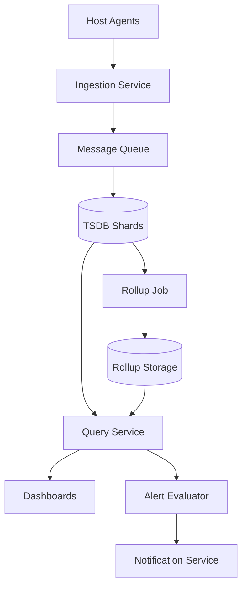
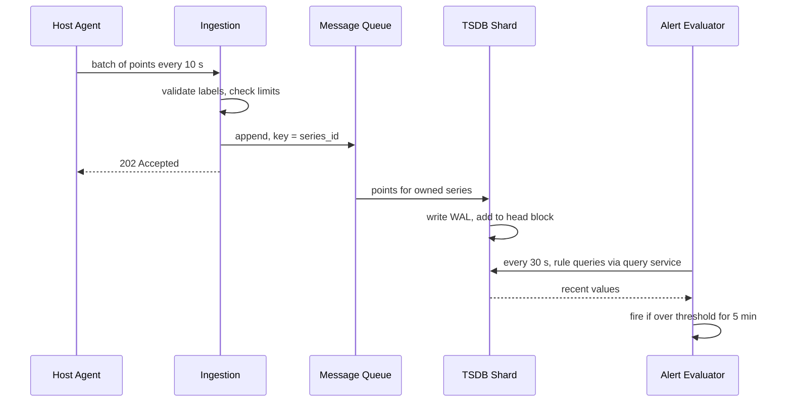

# Design a metrics and monitoring system (like Datadog or Prometheus)

> Collect, store, and query time-series metrics from many services, with dashboards and alerts.

This question is graded on write volume and on what the storage layout does with it. Millions of small numbers arrive every second, almost none are read individually, and queries ask for aggregates over time. The interviewer wants to see a storage format built for that pattern, a plan for the number of distinct series, and alerting that still works when other parts fail.

## 1. Requirements

**Functional**
- Collect metrics from services and hosts: counters (values that only go up), gauges (values that go up and down), and latency histograms.
- Store each metric as a time series: a sequence of (timestamp, value) points for one metric and one set of labels.
- Query and aggregate series for dashboards, for example the p99 latency of a service over 6 hours.
- Evaluate alert rules and send notifications when a rule fires.

**Non-functional**
- Ingest millions of points per second without dropping data during spikes.
- Dashboard queries over recent data return in about a second.
- Alerts fire within a minute of the condition starting.
- The monitoring system must stay up when the services it watches fail.

Agree out loud that recent data matters far more than old data. Most queries cover the last few hours, so old data can be stored at lower resolution. Also agree on the label limits, because unbounded labels like user ids create more series than any store can hold.

## 2. Estimation

Assumptions (all labeled as such):
- 100,000 hosts, each exposing 1,000 series, so 100 million active series.
- One point per series every 10 seconds.
- Compressed storage of about 2 bytes per raw point and 8 bytes per rollup bucket (min, max, sum, count).
- Raw data kept 15 days, 5-minute rollups kept 90 days, 1-hour rollups kept a year.

Computed numbers:
- Ingest rate: 100 million series / 10 seconds is 10 million points per second.
- Points per day: 10 million x 86,400 is 864 billion.
- Raw storage: 864 billion x 2 bytes is about 1.7 TB per day, so 15 days is about 26 TB.
- 5-minute rollups: 100 million series x 288 buckets per day is 28.8 billion buckets, or about 230 GB per day. Over 90 days that is about 21 TB.
- 1-hour rollups: 100 million x 24 x 365 is about 876 billion buckets, or about 7 TB.

See the [estimation cheat sheet](../cheat-sheets/estimation.md) for the reference numbers.

The ingest rate rules out a general-purpose database that writes one row per point with a B-tree index. It forces batching points in memory and writing them as large compressed blocks. A day of 5-minute rollups costs about a seventh of a day of raw data, so a year of history is affordable only at reduced resolution.

## 3. API

- `POST /ingest` with `{ points: [{ metric, labels, timestamp, value }] }` returns 202 Accepted.
- `GET /query?expr={expression}&start={t1}&end={t2}&step=60s` returns `{ series: [{ labels, points: [[t, v]] }] }`.
- `POST /alerts` with `{ expr, threshold, forDuration, severity, route }` returns `{ ruleId }`.

## 4. Data model

```
series:       series_id (PK) | metric_name | labels { service, host, region }
label_index:  (label_name, label_value) -> [ series_id ... ]
chunk:        (series_id, start_time) PK | compressed points for 2 hours
rollup:       (series_id, resolution, bucket_start) PK | min | max | sum | count
alert_rule:   rule_id (PK) | expr | threshold | for_duration | route
```

A query first finds matching series by label, then reads a time range for each. The label index is an inverted index (a map from each label value to the series that carry it). See [database indexing](../patterns/database-indexing.md). Points for one series are read together by time range, so storing them together in compressed chunks makes each query a few sequential reads.

## 5. Ingesting and storing time series

The first choice is how points reach the system.

| Approach | How | Trade-off |
|----------|-----|-----------|
| Pull (scrape) | The system calls each target's metrics endpoint every few seconds | A missed scrape shows a target is down, but the system must discover every target |
| Push | Agents on each host send points to an ingestion endpoint | Works for short jobs and hosts behind firewalls, but needs buffering for bursts |

Prometheus is known for pulling, and agent-based products like Datadog push. In a push design, a [message queue](../patterns/message-queues.md) between ingestion and storage stores bursts, so storage nodes can process more slowly than ingestion for a while without data loss.

Storage nodes are sharded by series id, so all points for one series go to one node. See [sharding and partitioning](../patterns/sharding-partitioning.md). Each node keeps the newest two hours of every series in memory, in a structure called the head block. A [write-ahead log](../patterns/write-ahead-log.md) records each batch first, so a crash does not lose the head block.

Compression makes the 2 bytes per point possible. Timestamps arrive at regular intervals, so the system stores the change in the gap between points, which is usually zero. Values change slowly, so each value is stored as its bitwise difference from the previous one. Facebook's published Gorilla paper describes this method and reports under 2 bytes per point on average. Full head blocks are flushed to disk as immutable chunks, and a background job builds rollups from them.

## 6. High-level design



The query service reads raw chunks for recent ranges and rollups for older ones, then merges them. The alert evaluator is another client of the query service, running its rules on a schedule.



Ingestion rejects batches that exceed label limits before they reach storage. The "for 5 minutes" condition on alerts stops one noisy point from paging an engineer.

## 7. Bottlenecks and trade-offs

- Write volume: batch in memory and write compressed blocks. See [batch vs stream processing](../patterns/batch-vs-stream-processing.md).
- Shard balance: assign series to nodes with [consistent hashing](../patterns/consistent-hashing.md) so adding a node moves few series.
- Node loss: keep two or three copies of each shard. See [replication](../patterns/replication.md).
- Silent failure of the pipeline: send a [heartbeat](../patterns/heartbeats.md) alert that always fires, and page if it stops arriving.

The most common follow-up is cardinality, the number of distinct series. Each new label value creates a new series, with its own head block and index entries. A label like user id can turn 1,000 series into millions in one deploy and exhaust memory. The answer is enforcement at ingestion: per-metric series limits, rejected labels, and a report of the top series creators. This trades some flexibility for a store that stays within its memory.

## The deep dives to expect

**How do you compute p99 latency across many hosts?** You cannot average per-host p99 values, because percentiles do not combine that way. Store histograms with fixed buckets on each host, sum the bucket counts across hosts, then compute the percentile from the summed histogram.

**How do you keep alerting working when storage is overloaded?** Run alert evaluation close to the data with its own capacity. Monitor the monitoring system from a separate small cluster in another region, so one failure cannot silence both.

**How do you avoid flooding on-call engineers during an outage?** Group alerts by service and region, and suppress lower alerts when a higher one, like "data center down," is firing. Send the grouped alert through a [notification system](design-notification-system.md) with rate limits.

**How do dashboards over 30 days stay fast?** Read 5-minute rollups instead of raw points. A 30-day panel then reads 8,640 points per series, against about 259,000 at raw resolution. Cache popular dashboards for a few seconds.

**What happens to points that arrive late or out of order?** Accept them while their head block is still in memory. Points older than that are rejected or written to a separate block that is merged later, because rewriting immutable chunks is expensive.

## Related pages

- Delivering the alerts: [design a notification system](design-notification-system.md).
- Another windowed counting pipeline: [design an ad click aggregator](design-ad-click-aggregator.md).
- Moving high-volume events through a log: [Kafka](../deep-dives/kafka-distributed-messaging.md).

## Go deeper

- Quick, focused prep: [System Design Interview Crash Course](https://www.designgurus.io/course/system-design-interview-crash-course?utm_source=github&utm_medium=repo&utm_campaign=grokking-system-design&utm_content=questions-design-metrics-monitoring)
- Full course: [Grokking the System Design Interview](https://www.designgurus.io/course/grokking-the-system-design-interview?utm_source=github&utm_medium=repo&utm_campaign=grokking-system-design&utm_content=questions-design-metrics-monitoring)
