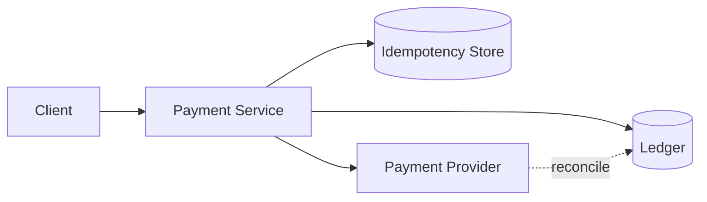

# Design a payment system

> Process payments reliably, without double-charging, with an accurate record of every transaction.

## 1. Requirements

**Functional**
- Charge a customer and pay out to a merchant.
- Integrate with external payment providers.
- Track the state of every transaction.

**Non-functional**
- Correctness above all (no lost or double payments).
- Strong consistency for money.
- Auditable and reconcilable.

## 2. The hard parts

- Idempotency: network retries must not charge twice. Every payment request carries an idempotency key, and the system records the result so a repeat returns the same outcome instead of charging again.
- Exactly-once effect: achieved with idempotency plus a durable record of each step, not by hoping a call happens once.
- Ledger: record money movements as immutable, double-entry entries (every debit has a matching credit), so balances are always reconstructable.

## 3. Deep dive

- State machine: a payment moves through states (initiated, authorized, captured, settled, failed, refunded) persisted at each step so it can resume after a crash.
- Async with reconciliation: external providers are slow and can fail; process asynchronously and reconcile against provider records to catch mismatches.
- Consistency: use strong consistency for the ledger; do not trade it away for money.

## 4. Trade-offs

- Latency vs safety: extra durability and confirmation steps cost time, but correctness wins for payments.
- At-least-once delivery plus idempotency gives an exactly-once effect without exactly-once messaging.

## High-level design

## Go deeper

- Full worked solution: the chapter [Designing Payment System](https://www.designgurus.io/course-play/grokking-system-design-interview-ii/doc/design-payment-system?utm_source=github&utm_medium=repo&utm_campaign=grokking-system-design&utm_content=questions-design-payment-system) in [Advanced System Design Interview, Volume II](https://www.designgurus.io/course/grokking-system-design-interview-ii?utm_source=github&utm_medium=repo&utm_campaign=grokking-system-design&utm_content=questions-design-payment-system), an 8-step walkthrough.
- A second, condensed walkthrough: the lesson [Design Stripe Payment Gateway](https://www.designgurus.io/course-play/system-design-interview-crash-course/doc/design-stripe-payment-gateway?utm_source=github&utm_medium=repo&utm_campaign=grokking-system-design&utm_content=questions-design-payment-system) in [System Design Interview Crash Course](https://www.designgurus.io/course/system-design-interview-crash-course?utm_source=github&utm_medium=repo&utm_campaign=grokking-system-design&utm_content=questions-design-payment-system).
- The API contract: the lesson [Capstone: Design a Payment API](https://www.designgurus.io/course-play/grokking-modern-api-design-interview/doc/capstone-design-a-payment-api?utm_source=github&utm_medium=repo&utm_campaign=grokking-system-design&utm_content=questions-design-payment-system) in [Grokking Modern API Design Interview](https://www.designgurus.io/course/grokking-modern-api-design-interview?utm_source=github&utm_medium=repo&utm_campaign=grokking-system-design&utm_content=questions-design-payment-system).
- The same system as microservices: the lesson [Case Study: A Payments and Wallet Platform](https://www.designgurus.io/course-play/grokking-microservices-for-system-design-interviews/doc/case-study-a-payments-and-wallet-platform?utm_source=github&utm_medium=repo&utm_campaign=grokking-system-design&utm_content=questions-design-payment-system) in [Grokking Microservices for System Design Interviews](https://www.designgurus.io/course/grokking-microservices-for-system-design-interviews?utm_source=github&utm_medium=repo&utm_campaign=grokking-system-design&utm_content=questions-design-payment-system).
- Full course: [Grokking the System Design Interview](https://www.designgurus.io/course/grokking-the-system-design-interview?utm_source=github&utm_medium=repo&utm_campaign=grokking-system-design&utm_content=questions-design-payment-system)
- The API contract for this system: [Design a payments API](https://github.com/design-gurus/api-design-interview/blob/main/questions/design-a-payments-api.md), in the free API Design Interview guide
