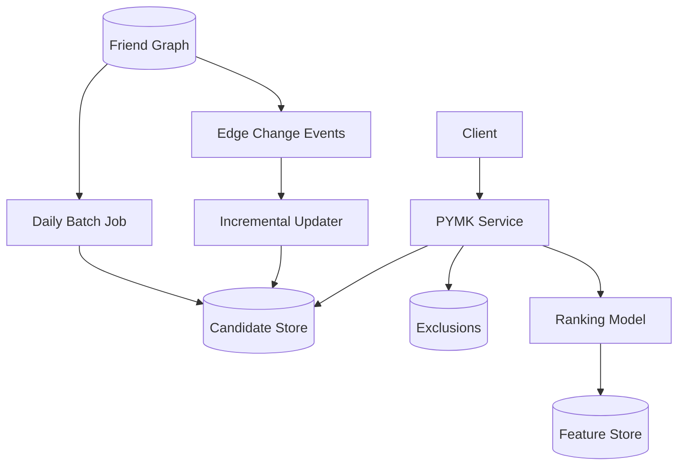
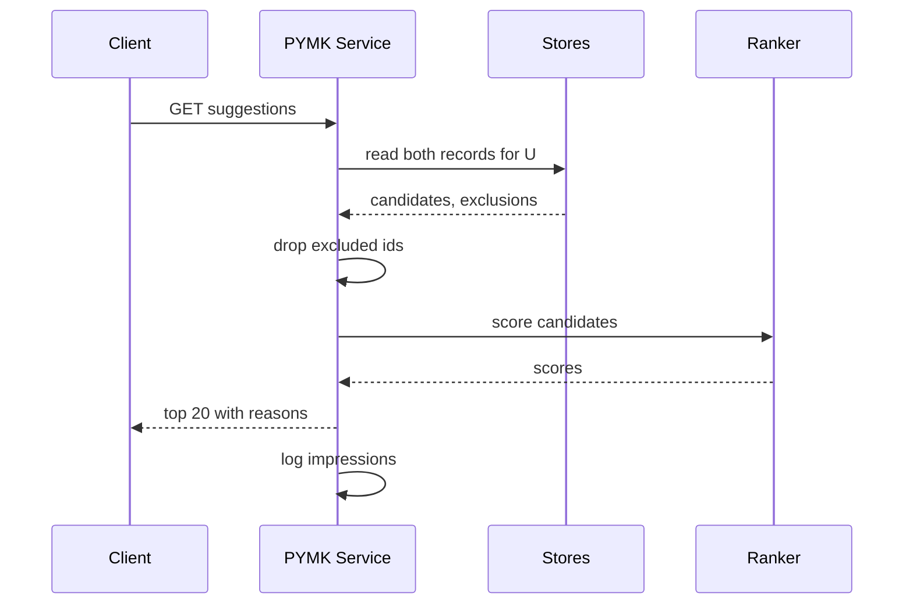

# Design "People You May Know" (Facebook)

> Suggest people a user might know, primarily from mutual connections in the social graph.

This question is graded on how you split work between offline and online. Counting friends of friends for billions of users is too expensive at request time and too slow to change in a nightly batch alone. The interviewer wants a candidate pipeline, a ranking step, and a clear answer on how fast a new friendship changes the suggestions.

## 1. Requirements

**Functional**
- Show a ranked list of people the user may know, on a dedicated page and in small widgets.
- Use mutual friends as the main signal, plus shared school, workplace, city, and imported contacts.
- Never suggest current friends, blocked users, or people the user dismissed.
- Let the user send a friend request or dismiss a suggestion.

**Non-functional**
- Low latency reads (under about 100 ms), since the widget appears inside the feed.
- Suggestions reflect a new friendship within minutes, not days.
- Privacy: a suggestion must never reveal private data, like who looked at whose profile.

Agree out loud that the goal is accepted friend requests, not clicks. That choice defines the label the ranking model learns from and the metric you report.

## 2. Estimation

Assumptions: 2 billion users, an average of 300 friends each, 1 billion daily active users, each loading suggestions twice a day, and 200 stored candidates per user.

- Reads: 1 billion times 2 is 2 billion per day. Divided by about 86,400 seconds, that is roughly 23,000 per second, or about 46,000 per second at a peak of twice the average.
- Two-hop paths: 300 friends times 300 friends each is up to 90,000 paths per user.
- Full daily recompute for active users: 1 billion times 90,000 is 90 trillion path steps per day.
- Candidate store: 200 candidates at 16 bytes each (id plus score) is 3.2 KB per user. Times 2 billion users, that is 6.4 TB.

See the [estimation cheat sheet](../cheat-sheets/estimation.md) for the reference numbers.

The 90 trillion figure forces the design. Nobody computes two-hop paths at request time, and even a batch job must prune: skip friends with very large friend lists and sample their neighbors instead. The 6.4 TB candidate store is modest, so serving is a key lookup, and the hard work stays offline.

## 3. API

- `GET /pymk?userId={u}&limit=20&cursor={c}` returns `{ suggestions: [{ userId, mutualCount, reason }], nextCursor }`. The `reason` is a short label like "12 mutual friends".
- `POST /pymk/{candidateId}/dismiss` returns `204`. The candidate is never shown again.
- `POST /friend-requests` with `{ toUserId, source: "pymk" }` returns `{ requestId }`. The `source` field feeds the training labels.

## 4. Data model

```
candidates  (key: user_id)
  user_id | [ { candidate_id, mutual_count, source, score } ... ] | computed_at

exclusions  (key: user_id)
  user_id | friend ids, blocked ids, dismissed ids, pending request ids

features  (key: user_id or user_id + candidate_id)
  user_id | school_ids | employer_ids | city | contact_hashes | activity stats

impressions  (append-only log)
  user_id | candidate_id | shown_at | action
```

Every read is "everything for user U", so all four records are keyed by user id in a key-value store. No query joins two users at read time. The impressions log is append-only and feeds training, so it lives in a log store rather than the serving database. See [SQL vs NoSQL](../cheat-sheets/sql-vs-nosql.md).

## 5. Generating and ranking candidates

**Candidate generation.** The main source is friends of friends: for each friend F of user U, every friend of F who is not U and not already U's friend. Counting how many paths reach each candidate gives the mutual friend count. Other sources add people with the same school or employer, and people whose phone number matches an imported contact.

There are three ways to keep friends-of-friends lists current:

| Approach | How | Trade-off |
|----------|-----|-----------|
| Request-time two-hop query | Read U's friends, then each friend's list, then count | Always fresh, but up to 90,000 reads per request |
| Daily batch | A job joins the edge table with itself and writes top candidates per user | Cheap per user, but a new friendship takes a day to matter |
| Batch plus incremental | Daily batch as a base, plus a stream job that updates candidates when an edge is added | Fresh within minutes, at the cost of two code paths that must agree |

The third is the usual answer. When U and V become friends, V's friends become new candidates for U, and U's friends become new candidates for V. In the other direction, each of U's friends gains V as a candidate, and each of V's friends gains U. With 300 friends each, that is about 1,200 small, bounded updates per new friendship. See [batch vs stream processing](../patterns/batch-vs-stream-processing.md).

**Filtering.** Remove current friends, blocked users, dismissed suggestions, and pending requests. Filtering runs at read time against the exclusions record, because a dismissal must take effect at once.

**Ranking.** A model predicts the chance that U sends a request and the candidate accepts. Mutual friend count is the strongest feature, but it is not the only one. Ten mutual friends from one tightly connected group, like a family, carry a different signal than ten scattered across work and school, and the model learns which counts for more.

## 6. High-level design



The graph side runs offline: the batch job rebuilds the base daily, and the incremental updater applies new friendships within minutes. The client side is the online path: the PYMK service reads candidates, removes exclusions, and asks the ranking model to score what is left.

The read path is short:



The candidate and exclusion records are read in parallel. Logging impressions after the response keeps it off the latency path and supplies negative labels.

## 7. Bottlenecks and trade-offs

- Two-hop explosion: prune high-degree nodes and sample their neighbors. See [sharding and partitioning](../patterns/sharding-partitioning.md) for splitting the batch join by user id.
- Fast exclusion checks across many candidates: a [Bloom filter](../patterns/bloom-filters.md), a compact structure that answers "definitely not in the set" or "maybe in the set", screens dismissed ids cheaply. A false positive only hides one valid candidate.
- Delivering edge changes to the updater: a [message queue](../patterns/message-queues.md) between the graph and the stream job. See the [Kafka deep dive](../deep-dives/kafka-distributed-messaging.md).
- Repeated reads of the same list: [cache](../patterns/caching.md) the ranked result for a short time per user.

The most common follow-up is freshness versus cost. The batch job alone is cheap but makes the feature feel stale right after a user adds friends, which is when they are most likely to add more. The incremental path targets exactly that moment. It handles only the users whose graph just changed, so its cost follows the rate of new friendships, not the number of users.

## The deep dives to expect

**How do you handle a user with 5,000 friends?** Their friends-of-friends set could reach millions. Treat them as a high-degree node: when expanding through them, sample a fixed number of their friends instead of all. A mutual friend who knows everyone is also weak evidence, so the ranker should give that path less weight.

**What about brand new users with no friends?** Fall back to other sources: imported contacts, school and employer, and city. After the first few friend requests are accepted, the incremental path starts producing friends-of-friends candidates within minutes.

**How do you avoid privacy problems?** Use only signals the user would expect, like mutual friends and shared networks. Never use profile views or messages as a reason.

**How do you measure success?** Use accepted requests per impression, not clicks. A suggestion that gets a request which is then ignored has a cost, since the recipient sees an unwanted request. Run changes as A/B tests on this metric (a random group gets the change, the rest are the control).

**Should dismissals be permanent?** Yes for the pair. Apply them at read time from the exclusions record, even if the batch job still produces that candidate.

## Related pages

- How the underlying graph is stored and queried: [design LinkedIn connections](design-linkedin-connections.md).
- The general candidate generation and ranking structure: [design a recommendation system](design-recommendation-system.md).
- The batch model behind the daily job: [MapReduce deep dive](../deep-dives/mapreduce-batch-processing.md).

## Go deeper

- Quick, focused prep: [System Design Interview Crash Course](https://www.designgurus.io/course/system-design-interview-crash-course?utm_source=github&utm_medium=repo&utm_campaign=grokking-system-design&utm_content=questions-design-people-you-may-know)
- Full course: [Grokking the System Design Interview](https://www.designgurus.io/course/grokking-the-system-design-interview?utm_source=github&utm_medium=repo&utm_campaign=grokking-system-design&utm_content=questions-design-people-you-may-know)