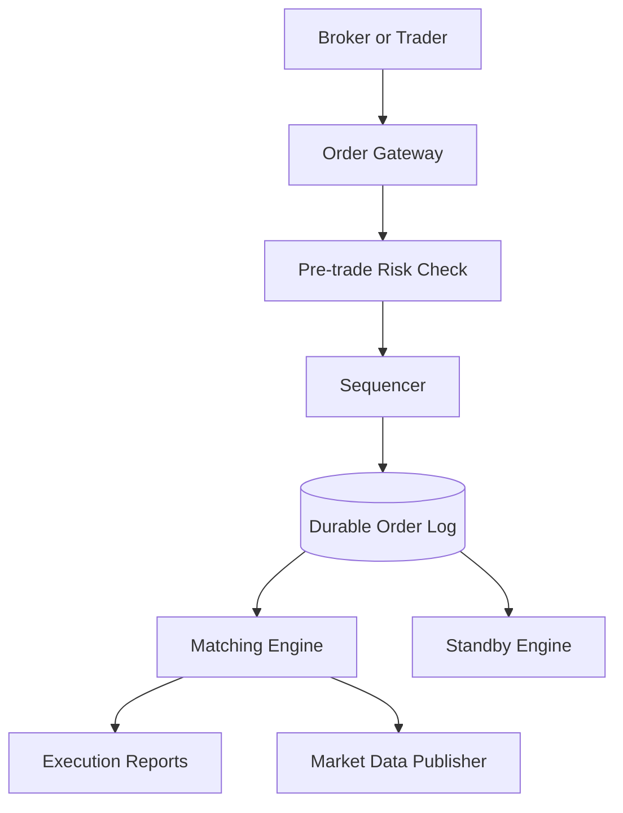
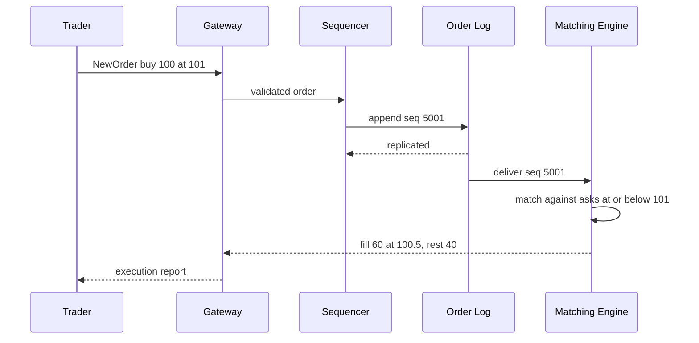

# Design a stock exchange

> A trading system that matches buy and sell orders fairly, with very low latency and strict correctness.

This question is graded on ordering, not on scale. Every participant must be treated in the exact order their orders arrived, every trade must be recorded once, and the system must recover to the same state after a crash. The common mistake is to use databases and queues built for web traffic, when the correct design is a single-threaded engine fed by one ordered log.

## 1. Requirements

**Functional**
- Accept limit orders (buy or sell at a stated price or better) and market orders (buy or sell at the best available price).
- Cancel or modify a resting order, which is an order waiting in the book.
- Match orders by price-time priority and report each fill to both sides.
- Publish market data: the order book and every trade.

**Non-functional**
- Matching latency in tens of microseconds, with low variation.
- Strict fairness: orders are handled in arrival order, and replays produce identical trades.
- No lost or duplicated orders or trades, and full recovery after a crash.
- High throughput at the market open and close.

Agree out loud that determinism is a requirement, not an optimization. If replaying the same orders can produce different trades, recovery and audit are impossible.

## 2. Estimation

Assumptions (labeled, not measured):
- 10,000 listed symbols.
- 1 billion order messages per day, including cancels and modifications.
- A 6.5 hour trading session, so 23,400 seconds.
- Peak rate at ten times the average, and the busiest symbol takes 5 percent of traffic.
- 100 bytes per message, and 10,000 resting orders per symbol on average.

Computed:
- Average rate: 1 billion / 23,400 = about 42,700 messages per second.
- Peak rate: about 427,000 messages per second.
- Busiest symbol at peak: 5 percent of 427,000 = about 21,400 per second.
- Log size: 1 billion x 100 bytes = 100 GB per day.
- Order book memory: 10,000 symbols x 10,000 orders x 100 bytes = 10 GB.

See the [estimation cheat sheet](../cheat-sheets/estimation.md) and [latency numbers](../cheat-sheets/latency-numbers.md).

These numbers show that one thread per symbol is enough. If a match takes about a microsecond, one thread handles about a million messages per second, far above the 21,400 needed for the busiest symbol. All order books fit in 10 GB of memory, so the engine never reads a disk while matching. The real constraint is latency, which rules out network calls and database queries on the matching path.

## 3. API

- `NewOrder { clientOrderId, symbol, side, type, price?, qty }` returns `{ orderId, status: "accepted" }` or a rejection.
- `CancelOrder { orderId }` returns `{ status: "cancelled" }` or "too late" if it already filled.
- `ExecutionReport` (pushed to the trader) carries `{ orderId, fillPrice, fillQty, remainingQty }`.
- `Subscribe { symbol }` streams book updates and trades as market data.

Real exchanges commonly use the FIX protocol or binary protocols over persistent connections, not HTTP, because each request must avoid connection setup cost.

## 4. Data model

```
order:     order_id | account_id | symbol | side | type | price | qty
           | remaining | seq_no | received_at
trade:     trade_id | symbol | buy_order_id | sell_order_id | price | qty | seq_no
book (in memory, per symbol):
           bids: price level -> FIFO queue of orders   (highest first)
           asks: price level -> FIFO queue of orders   (lowest first)
           index: order_id -> position in its queue    (for cancels)
```

The access pattern is "find the best opposite price, then take orders from the front of its queue". A sorted map of price levels gives the best price directly, and a FIFO queue at each level gives time priority. The hash index makes a cancel a direct lookup instead of a scan. Durable storage holds only the ordered log, and everything else is rebuilt from it.

## 5. Sequencing and matching orders

A sequencer is the single point that stamps each incoming message with the next sequence number and appends it to a durable log. The matching engine reads that log in order. Because the input order is fixed and the engine is deterministic, its output is fixed too. This is a [write-ahead log](../patterns/write-ahead-log.md) used as the source of truth, the idea behind [event sourcing](../patterns/event-sourcing-cqrs.md).

| Approach | How | Trade-off |
|----------|-----|-----------|
| Many threads per book, with locks | Threads share one book and lock it | Lock waits add unpredictable latency, and replay order is not guaranteed |
| One thread per symbol, fed by a log | Each book is owned by one thread that reads in sequence | Deterministic and no locks, but one symbol cannot use more than one core |
| Database transaction per order | Store the book in tables and match in SQL | Correct, but milliseconds per order, far too slow |

The single-threaded engine is the standard answer. Engineers at LMAX, a trading venue, have written publicly about running their core business logic on one thread for this reason. Matching itself is short: an incoming buy at 101 fills against the lowest asks at or below 101, oldest first, until it is filled or no matching price remains. The rest of the order rests in the book.

Symbols are independent, so the system [partitions](../patterns/sharding-partitioning.md) by symbol. Each partition has its own sequencer, log and engine, and partitions spread across machines.

## 6. High-level design



The gateway authenticates and validates messages, and the risk check confirms the account can afford the order. The sequencer orders messages, the log makes them durable, and the primary and standby engines both read the same log. Fills go back to traders, and book changes go out as market data.



The engine never waits on anything outside its own memory. The log append happens before matching, so nothing can be matched and then lost.

## 7. Bottlenecks and trade-offs

- Engine failure: a hot standby replays the same log and holds the same state, and a [leader election](../patterns/leader-election.md) step promotes it, detected by [heartbeats](../patterns/heartbeats.md).
- Log durability: [replicate](../patterns/replication.md) each entry to another machine before matching, as in a [Kafka](../deep-dives/kafka-distributed-messaging.md) style log.
- Duplicate submissions: the `clientOrderId` makes order entry [idempotent](../patterns/idempotency.md), so a resent order is recognized and ignored.
- Burst at the open: gateways apply [backpressure](../patterns/backpressure.md) and per-client [rate limits](../patterns/rate-limiting.md).

The most common follow-up is latency against durability. Writing every message to disk with a forced flush before matching is safe and adds a disk write to every order. Replicating the message to the memory of a second machine is faster and survives the loss of one machine, though not of both. Many designs choose replication to memory, then write to disk in the background. State which failure you are protecting against, because that decides the answer.

## The deep dives to expect

**How does recovery work after the engine crashes?** Start from the latest snapshot of the order books, then replay log entries after that snapshot's sequence number. Because the engine is deterministic, the rebuilt state matches the state before the crash exactly.

**How do you keep the system fair?** Fairness means the sequence number, not the arrival time at some later step, decides priority. Put a single sequencer per symbol and give every client the same network path to it, so no gateway gets an advantage.

**How is market data distributed?** Send incremental updates, each with a sequence number, so a client can detect a gap. A client that misses updates requests a snapshot and then applies updates after it.

**What happens when a cancel and a fill race?** Both go through the same sequencer, so one is first. If the fill is first, the cancel returns "too late".

**Why not just use a database?** A database transaction costs milliseconds and adds lock contention. The order log provides durability, snapshots provide fast restarts, and trades go to a database afterward for settlement and reporting, outside the matching path.

## Related pages

- Recording money movement after the trade: [design a payment system](design-payment-system.md).
- Ordered, durable logs in depth: [design a distributed message queue](design-distributed-message-queue.md).
- Another write-contention problem with strict correctness: [design a flash sale system](design-flash-sale-system.md).

## Go deeper

- Quick, focused prep: [System Design Interview Crash Course](https://www.designgurus.io/course/system-design-interview-crash-course?utm_source=github&utm_medium=repo&utm_campaign=grokking-system-design&utm_content=questions-design-stock-exchange)
- Full course: [Grokking the System Design Interview](https://www.designgurus.io/course/grokking-the-system-design-interview?utm_source=github&utm_medium=repo&utm_campaign=grokking-system-design&utm_content=questions-design-stock-exchange)