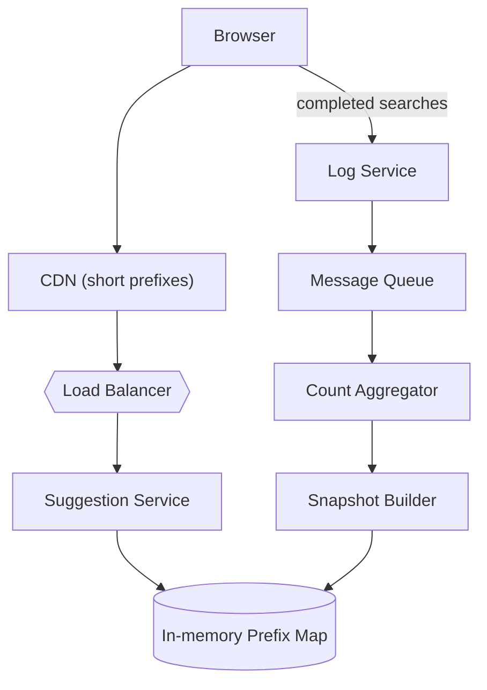
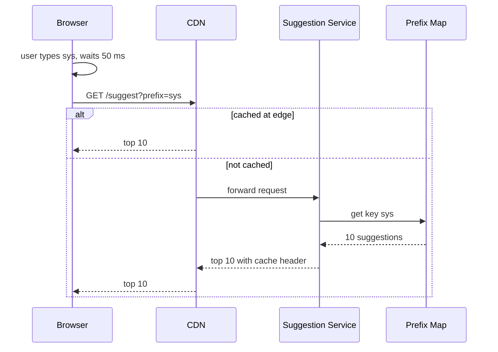

# Design typeahead / autocomplete

> Suggest completions as a user types, ranked by popularity, with very low latency.

This question is graded on one idea: the work must happen before the user types, not while they type. A design that searches for matches on every keystroke will miss the latency budget at any real volume. The interviewer wants to see precomputed answers per prefix, a pipeline that keeps them fresh, and a clear view of where the request volume comes from.

## 1. Requirements

**Functional**
- Given a prefix, return the top 10 completions.
- Rank completions by how often people searched for them, with recent searches weighted more.
- Reflect new trending queries within minutes to hours.
- Optional: personal history, per-language suggestions, filtering offensive terms.

**Non-functional**
- Very low latency: under about 100 ms end to end, so suggestions appear before the next keystroke.
- High availability: a failed request should show stale or no suggestions, never an error.
- Read-heavy: every search generates several suggestion requests and only one log entry.
- Suggestions may be slightly stale.

Agree out loud that freshness is measured in minutes, not milliseconds. That single agreement allows the serving path to read from a prebuilt snapshot, with no writes on the hot path. Also confirm the size of the result list, because "top 10" decides how much is stored per prefix.

## 2. Estimation

Assumptions (all labeled as such):
- 1 billion searches per day.
- An average query is 20 characters long.
- The client sends one request per 2 characters typed, after a short pause, so about 10 requests per search.
- After dropping rare queries, 100 million distinct queries remain.

Computed numbers:
- Requests: 1 billion x 10 is 10 billion per day. Divided by 86,400 seconds, that is about 116,000 per second. Assume peak is 2 times average, so about 232,000 per second.
- Query log writes: 1 billion / 86,400 is about 11,600 per second.
- Prefix entries: at most 100 million queries x 20 prefixes is 2 billion, and shared prefixes make the real number much lower. Plan for 1 billion.
- Storage: each entry holds a 20-byte prefix and 10 pairs of an 8-byte suggestion id and a 4-byte score, so about 140 bytes. 1 billion x 140 bytes is 140 GB.

See the [estimation cheat sheet](../cheat-sheets/estimation.md) for the reference numbers.

These numbers say the data is small and the request rate is large. 140 GB fits in memory across a few shards, so disk reads have no place on the hot path. The 232,000 requests per second are the real load, which forces replicas, caching close to the user, and a client that does not send a request for every key.

## 3. API

- `GET /suggest?prefix={p}&limit=10&lang={l}` returns `{ suggestions: [{ text, score }] }`.
- Internal: `POST /log` with `{ query, userId?, timestamp }` records a completed search. It returns 202 Accepted and is processed asynchronously.

## 4. Data model

```
query_counts:   query (PK) | count_last_hour | count_last_week | score
prefix_index:   prefix (PK) -> [ (suggestion_id, score) x 10 ]
suggestion:     suggestion_id (PK) | text
snapshot_meta:  version (PK) | built_at | shard_map
```

The serving access pattern is an exact key lookup: one prefix in, one short list out. That points to an in-memory key-value map, not a database query. The `query_counts` table is written in bulk by the aggregation job and read only when building a new snapshot, so it can live in a batch-friendly store.

## 5. Precomputing top-k suggestions per prefix

There are three common ways to answer "top 10 for this prefix."

| Approach | How | Trade-off |
|----------|-----|-----------|
| Search at request time | Walk a trie (prefix tree) from the prefix node and collect the best matches below it | Small storage, but a short prefix like "a" has millions of matches to scan |
| Trie with top-k at each node | Each trie node stores its 10 best completions | One walk of a few steps per request, at the cost of storing 10 entries per node |
| Flat prefix map | A hash map from every prefix string to its 10 completions | One key lookup, easy to shard and cache, but more memory than a trie |

The flat map is the usual answer for a distributed design. It turns each request into a single key lookup, and it shards by key without splitting a trie across machines. The trie remains useful as the build tool: build it offline, then flatten each node's top 10 into the map.

Ranking uses a score, not a raw count. A common choice is a time-decayed count, where each past hour's searches count a little less than the hour after. This lets a trending query rise within hours without losing long-term favorites.

The update pipeline runs beside serving. Search logs go to a [message queue](../patterns/message-queues.md), a stream job counts queries per hour, and a batch job rebuilds the prefix map. New snapshots replace old ones per shard, so a request never sees a half-built map. See [batch vs stream processing](../patterns/batch-vs-stream-processing.md).

## 6. High-level design



The CDN, suggestion service, and prefix map form the read path, which touches only memory. The log service, queue, and aggregator form the write path, which never blocks a suggestion request. The snapshot builder is the only writer to the prefix map.



The client waits for a short pause before sending, so fast typists generate fewer requests. One- and two-letter prefixes are shared by everyone, so the CDN (a network of edge servers near users) answers most of them. Only longer, rarer prefixes reach the service.

## 7. Bottlenecks and trade-offs

- Read volume: replicate each shard and cache short prefixes at the edge. See [replication](../patterns/replication.md) and [CDN](../patterns/cdn.md).
- Hot shards: sharding by the first letter overloads "s" and "a". Shard by a hash of the prefix instead. See [sharding and partitioning](../patterns/sharding-partitioning.md).
- Repeat lookups: cache the most common prefixes in each service instance. See [caching](../patterns/caching.md).
- Abusive clients: limit request rate per user. See [rate limiting](../patterns/rate-limiting.md).

The most common follow-up is freshness against cost. Rebuilding the whole map every few minutes is expensive, and rebuilding once a day misses breaking news. A common answer is two layers: a full rebuild on a slow schedule, and a small "trending" overlay updated every few minutes from the stream. The service merges the overlay into results, which keeps rebuild cost low and still shows a sudden spike quickly.

## The deep dives to expect

**How do you keep offensive or unsafe suggestions out?** Filter at build time against a blocklist, so the serving path never sees them. Keep a fast removal path that deletes a phrase from the live map without waiting for the next build. Removal must be quick because one bad suggestion is shown to many users.

**How would you add personalization?** Keep a small per-user history store and fetch it beside the global suggestions. Merge the two lists in the service, giving recent personal queries a higher score. Personal results must not be cached at the CDN, so they carry a private cache header.

**What happens when a shard dies?** Each shard has several replicas, and the load balancer stops sending traffic to a failed one. If every replica of a shard is down, return an empty list for those prefixes. Users keep typing and search still works.

**How do you support many languages?** Build a separate prefix map per language and pick it from the request's language field. Normalize text before lookup, for example lowercasing and removing accents, so that small variations map to one key.

**How large can a prefix get before you stop storing it?** Most value is in the first 15 to 20 characters. Past that, matches are rare and the map would grow with little gain, so cap the stored prefix length and stop suggesting beyond it.

## Related pages

- The search system this feeds: [design Google Search](design-google-search.md).
- Another top-k ranking problem: [design a gaming leaderboard](design-gaming-leaderboard.md).
- Moving search logs reliably: [Kafka](../deep-dives/kafka-distributed-messaging.md).

## Go deeper

- Quick, focused prep: [System Design Interview Crash Course](https://www.designgurus.io/course/system-design-interview-crash-course?utm_source=github&utm_medium=repo&utm_campaign=grokking-system-design&utm_content=questions-design-typeahead-autocomplete)
- Full course: [Grokking the System Design Interview](https://www.designgurus.io/course/grokking-the-system-design-interview?utm_source=github&utm_medium=repo&utm_campaign=grokking-system-design&utm_content=questions-design-typeahead-autocomplete)
