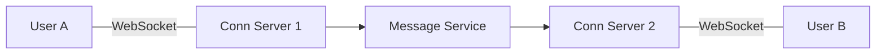

# Design WhatsApp

> A real-time messaging service for one-to-one and group chats, with delivery status and presence.

## 1. Requirements

**Functional**
- Send and receive messages in one-to-one and group chats.
- Delivery and read receipts (sent, delivered, read).
- Online and last-seen presence.
- Message history.

**Non-functional**
- Low latency (messages feel instant).
- High availability.
- Ordered delivery within a conversation.
- At-least-once delivery; no lost messages.

## 2. Estimation

Assume hundreds of millions of daily users and tens of billions of messages per day. Messages are small, so the challenge is connection management and routing at scale, not raw storage.

See the [estimation cheat sheet](../cheat-sheets/estimation.md).

## 3. The core: persistent connections

Unlike a request-response API, chat needs the server to push messages to clients. Use long-lived connections (WebSocket) held by a fleet of connection servers. A user is connected to one server; a routing layer knows which server holds which user so a message can be delivered to the right place.

## 4. Data model and storage

- Messages stored per conversation, partitioned by conversation id, ordered by time.
- A message queue between senders and the delivery path absorbs spikes and enables retries (see [message queues](../patterns/message-queues.md)).
- Offline users: store undelivered messages and push them when the user reconnects.

## 5. Deep dive

- Group chat: a message fans out to all members; for large groups, fan-out is the scaling concern.
- Presence: heartbeats update online status; last-seen is eventually consistent.
- Delivery receipts: acknowledgements flow back through the same path.
- Ordering: use per-conversation sequence numbers, not global ordering.

## 6. Bottlenecks and trade-offs

- Managing millions of concurrent connections; scale connection servers horizontally with a routing layer.
- Group fan-out; cap group size or fan out asynchronously.
- Delivery guarantees vs latency; at-least-once plus client-side dedup is the common choice.

## Go deeper

- Full worked solution: the lesson [Design WhatsApp](https://www.designgurus.io/course-play/system-design-interview-crash-course/doc/design-whatsapp?utm_source=github&utm_medium=repo&utm_campaign=grokking-system-design&utm_content=questions-design-whatsapp) in [System Design Interview Crash Course](https://www.designgurus.io/course/system-design-interview-crash-course?utm_source=github&utm_medium=repo&utm_campaign=grokking-system-design&utm_content=questions-design-whatsapp), free to read as a preview.
- The same one-to-one messaging core: the lesson [Designing Facebook Messenger](https://www.designgurus.io/course-play/grokking-the-system-design-interview/doc/designing-facebook-messenger?utm_source=github&utm_medium=repo&utm_campaign=grokking-system-design&utm_content=questions-design-whatsapp) in [Grokking the System Design Interview](https://www.designgurus.io/course/grokking-the-system-design-interview?utm_source=github&utm_medium=repo&utm_campaign=grokking-system-design&utm_content=questions-design-whatsapp).
- The same system as microservices: the lesson [Case Study: A Real-Time Chat and Presence System](https://www.designgurus.io/course-play/grokking-microservices-for-system-design-interviews/doc/case-study-a-realtime-chat-and-presence-system?utm_source=github&utm_medium=repo&utm_campaign=grokking-system-design&utm_content=questions-design-whatsapp) in [Grokking Microservices for System Design Interviews](https://www.designgurus.io/course/grokking-microservices-for-system-design-interviews?utm_source=github&utm_medium=repo&utm_campaign=grokking-system-design&utm_content=questions-design-whatsapp).
- The mobile client design: the lesson [Chat App](https://www.designgurus.io/course-play/grokking-modern-mobile-system-design-interview/doc/chat-app?utm_source=github&utm_medium=repo&utm_campaign=grokking-system-design&utm_content=questions-design-whatsapp) in [Grokking Modern Mobile System Design Interview](https://www.designgurus.io/course/grokking-modern-mobile-system-design-interview?utm_source=github&utm_medium=repo&utm_campaign=grokking-system-design&utm_content=questions-design-whatsapp).
- The API contract: the lesson [Interview Question: Design a Chat API](https://www.designgurus.io/course-play/grokking-modern-api-design-interview/doc/interview-question-design-a-chat-api?utm_source=github&utm_medium=repo&utm_campaign=grokking-system-design&utm_content=questions-design-whatsapp) in [Grokking Modern API Design Interview](https://www.designgurus.io/course/grokking-modern-api-design-interview?utm_source=github&utm_medium=repo&utm_campaign=grokking-system-design&utm_content=questions-design-whatsapp).
- Read more (free): [How to Design a Real-Time Chat Application (WhatsApp)](https://www.designgurus.io/blog/design-chat-application?utm_source=github&utm_medium=repo&utm_campaign=grokking-system-design&utm_content=questions-design-whatsapp)
- The client side of this design: [Design a chat app](https://github.com/design-gurus/frontend-system-design-interview/blob/main/questions/design-a-chat-app.md), in the free Frontend System Design Interview guide
