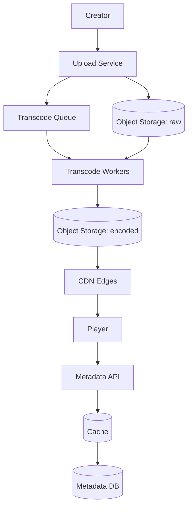
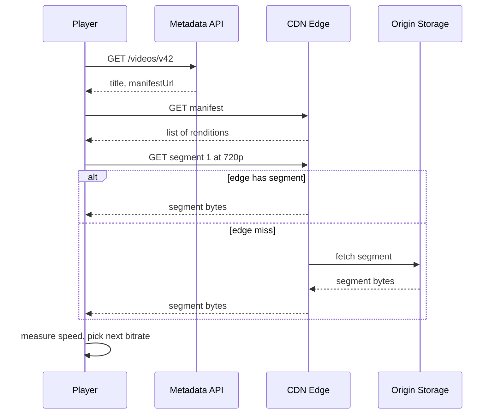

# Design YouTube

> A video platform to upload, process, store, and stream videos to a global audience, with search and recommendations.

This question is graded on two separate paths and on whether you keep them separate. The upload path is slow, heavy and offline: it turns one raw file into many encoded versions. The watch path is fast and enormous, and almost none of it should touch your own servers. Candidates who draw one service that does both usually run into trouble at the estimation step.

## 1. Requirements

**Functional**
- Upload a video, with resume after a dropped connection.
- Transcode each upload into several resolutions and bitrates.
- Stream with adaptive quality that follows the viewer's bandwidth.
- Show metadata, view counts and search results.

**Non-functional**
- Playback starts in about two seconds and rarely pauses to rebuffer.
- Very high availability for watching; uploads can tolerate minutes of processing delay.
- Global audience, huge storage and very high outbound bandwidth.
- Read-heavy: views outnumber uploads by many orders of magnitude.

Agree out loud that a new video may take a few minutes to become watchable after upload. That concession lets the whole upload side run as an asynchronous pipeline, which is where most of the design freedom comes from.

## 2. Estimation

Assumptions (labeled, not measured):
- 500 hours of video uploaded per minute, average video length 10 minutes.
- All encoded versions of one hour of video total 3 GB.
- 1 billion hours watched per day at an average of 2.5 Mbps.
- 5 billion video page views per day.

Computed:
- Uploaded video per day: 500 x 60 x 24 = 720,000 hours.
- Uploads per second: 720,000 hours x 6 videos per hour = 4.32 million videos per day, and 4.32 million / 86,400 = 50 per second.
- Storage per day: 720,000 x 3 GB = 2,160,000 GB, about 2.2 PB. Per year: 2.16 PB x 365 = about 790 PB, close to an exabyte.
- Concurrent streams: 1 billion hours x 3,600 seconds = 3.6 trillion stream-seconds per day, and 3.6 trillion / 86,400 = about 41.7 million streams at any moment.
- Egress: 41.7 million x 2.5 Mbps = about 104 Tbps on average.
- Metadata reads: 5 billion / 86,400 = about 58,000 per second.

See the [estimation cheat sheet](../cheat-sheets/estimation.md) for the reference numbers.

The egress figure decides the design. No origin data center serves 104 Tbps, so video bytes must come from a [CDN](../patterns/cdn.md) (a network of edge servers placed close to viewers). The storage figure rules out keeping every version on fast disks, so cold videos move to cheaper storage tiers.

## 3. API

- `POST /uploads` with `{ title, sizeBytes }` returns `{ uploadId, chunkSize }`.
- `PUT /uploads/{uploadId}/chunks/{n}` sends one chunk of bytes and returns `{ received: n }`.
- `POST /uploads/{uploadId}/complete` returns `{ videoId, status: "processing" }`.
- `GET /videos/{videoId}` returns `{ title, channel, views, manifestUrl, status }`.
- `GET /search?q=` returns a ranked list of `{ videoId, title, thumbnailUrl }`.

## 4. Data model

```
videos:      video_id (PK) | channel_id | title | status | duration | created_at
renditions:  video_id | resolution | bitrate | codec | manifest_path
chunks:      upload_id | chunk_no | object_key | checksum
view_counts: video_id (PK) | count   (updated in batches)
```

The hot access pattern is a key lookup by `video_id` on every page view, about 58,000 per second, so metadata sits in a sharded store behind a cache. Video bytes never go in a database. They are immutable files in object storage, addressed by path. See [sharding and partitioning](../patterns/sharding-partitioning.md).

## 5. Transcoding and adaptive streaming

Transcoding means decoding the raw upload and re-encoding it into standard formats. Each upload becomes a ladder of renditions, for example 240p up to 4K, and each rendition is cut into segments of a few seconds. A manifest file lists every rendition and its segments. This is the basis of HLS and DASH, the two common adaptive streaming formats.

| Approach | How | Trade-off |
|----------|-----|-----------|
| Encode the whole file on one machine | One worker encodes each rendition start to finish | Simple, but a two-hour video takes hours and one crash restarts everything |
| Split into segments, encode in parallel | Cut at keyframes, encode segments on many workers, then stitch | Minutes instead of hours and cheap retries, but needs a coordinator |

The segmented approach is the standard answer. A keyframe is a frame the decoder can start from without earlier frames, so cutting there keeps segments independent. A job queue holds one task per segment and rendition. Workers pull tasks, so a backlog grows the queue instead of overloading workers. See [message queues](../patterns/message-queues.md) and [backpressure](../patterns/backpressure.md).

On playback, the player downloads the manifest, then fetches segments one by one. It measures how fast each segment arrived and picks the next segment's bitrate from that. A slow network drops to a lower rendition within a few seconds instead of stalling.

## 6. High-level design



The upper part is offline. The upload service stores chunks and, on completion, enqueues transcode tasks. Workers write segments and manifests to encoded storage and mark the video ready. The lower part is the hot path: the player talks to the metadata API once, then streams bytes from the CDN.



The metadata call is the only request that reaches your services. Everything after it is a static file fetch, which is why the CDN carries the 104 Tbps and the origin sees only cache misses.

## 7. Bottlenecks and trade-offs

- Egress: serve segments from the [CDN](../patterns/cdn.md) and keep origin traffic to misses.
- Metadata reads: put a [cache](../patterns/caching.md) in front of the store and add [read replicas](../patterns/replication.md).
- Transcode spikes: queue the work and scale workers on queue depth, using [message queues](../patterns/message-queues.md).
- Duplicate chunk uploads after retries: make chunk writes [idempotent](../patterns/idempotency.md) (repeating the request has no extra effect) by keying on upload id and chunk number.
- Storage cost: move rarely watched renditions to colder, cheaper storage. Large, write-once files suit chunked file systems like [GFS](../deep-dives/gfs-distributed-file-system.md).

The most common follow-up is popular versus long-tail content. A small share of videos receives most views, and those stay cached in every edge. The long tail is the reverse: millions of videos watched a few times each, which miss the edge and go to origin. Pushing every video to every edge wastes storage, while pulling on demand gives rare videos a slower first start. The usual answer is to pull on demand and pre-push only what a channel's history predicts will be popular.

## The deep dives to expect

**How do resumable uploads work?** The client splits the file into chunks of a few megabytes and uploads them with their numbers. The server records each received chunk with a checksum. After a disconnect, the client asks which chunks arrived and sends only the missing ones.

**How do you make a new video watchable quickly?** Encode a low rendition like 360p first and publish the video as soon as it is done. Higher renditions finish later and get added to the manifest.

**How do you count views at this volume?** Do not update one row per view. Send view events to a log, aggregate them in short windows, and add the totals in batches. The count lags by seconds, which nobody notices. See the [likes counter](design-youtube-likes-counter.md) for the full design.

**How does search work?** A separate index is built from titles, descriptions and captions, and updated from events when a video becomes ready. It is eventually consistent with the metadata store, which is acceptable for search.

**What if a transcode worker dies mid-task?** The task returns to the queue after a timeout and another worker repeats it. Segment outputs are written to deterministic paths, so a repeated task overwrites the same file instead of creating a duplicate.

## Related pages

- The same pipeline from a curated catalog angle: [design Netflix](design-netflix.md).
- View and like counts at scale: [design a YouTube likes counter](design-youtube-likes-counter.md).
- Chunked, resumable uploads in more depth: [design Dropbox](design-dropbox.md).

## Go deeper

- Quick, focused prep: [System Design Interview Crash Course](https://www.designgurus.io/course/system-design-interview-crash-course?utm_source=github&utm_medium=repo&utm_campaign=grokking-system-design&utm_content=questions-design-youtube)
- Full course: [Grokking the System Design Interview](https://www.designgurus.io/course/grokking-the-system-design-interview?utm_source=github&utm_medium=repo&utm_campaign=grokking-system-design&utm_content=questions-design-youtube)