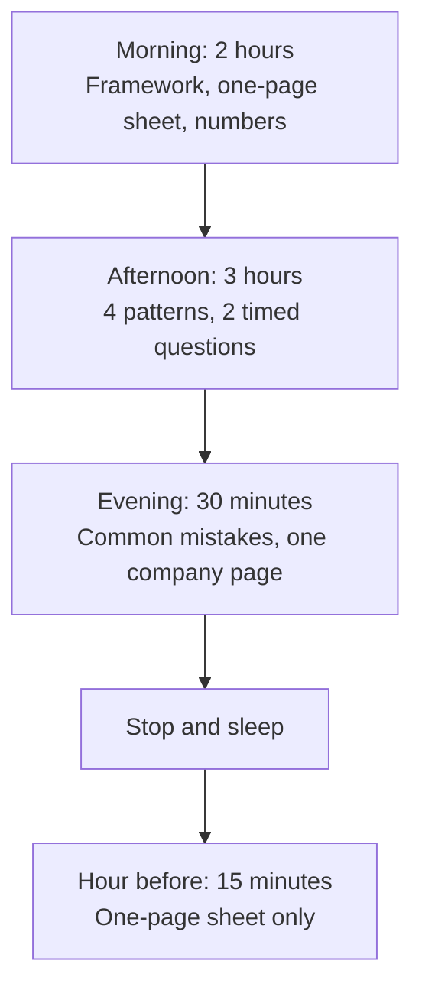

# 1-day plan: the interview is tomorrow

> This plan uses one day and about 6 hours to cover the framework, the one-page sheet, the key numbers, 4 patterns, and 2 questions practiced out loud.

This plan is for a reader whose interview is tomorrow and who has one day to prepare. It assumes about 6 hours of study: 5.5 hours today in three timed blocks, and 15 minutes in the hour before the interview.

The plan is triage, which means choosing the few things that matter most and leaving the rest. The repo has 30 patterns and 19 deep dives. Today you will read 4 patterns and no deep dives. One day cannot teach system design, but it can give you a structure that you can follow when you are nervous. If you have more days, use the [1-week crash plan](1-week-plan.md) instead.

## Morning: the structure (2 hours)

| Time | What to do |
|------|------------|
| 45 min | Read the [interview framework](../cheat-sheets/interview-framework.md). Then close the page and write its seven steps, with the minutes for each, on a blank page. |
| 30 min | Read [system design in one page](../cheat-sheets/system-design-in-one-page.md) twice. You will read this sheet again tomorrow. |
| 45 min | Read [estimation](../cheat-sheets/estimation.md) and [latency numbers](../cheat-sheets/latency-numbers.md). Then size one system by hand, for example a service with 10 million daily users. |

The framework is the fixed order of steps for a 45-minute round, from requirements to trade-offs. It matters more than any other page today, because it tells you what to say next when you do not know the answer.

For the estimation exercise, produce three numbers only: requests per second, storage per day, and the ratio of reads to writes. Round every figure, because interviewers grade the method and an exact result adds nothing.

**You are done with the morning when** you can write the seven steps and their minutes from memory, and turn daily users into requests per second without a calculator.

## Afternoon: four patterns and two questions (3 hours)

A pattern is a reusable building block that appears in many designs. Spend 15 minutes on each of these four, and no more.

| Time | Pattern | The one thing to remember |
|------|---------|---------------------------|
| 15 min | [Caching](../patterns/caching.md) | A copy of frequently read data in memory makes reads fast, but the copy can be out of date. |
| 15 min | [Load balancing](../patterns/load-balancing.md) | One entry point spreads requests across many servers and stops sending traffic to a failed server. |
| 15 min | [Replication](../patterns/replication.md) | Extra copies of the data survive a failure and serve more reads, but copies can lag. |
| 15 min | [Sharding and partitioning](../patterns/sharding-partitioning.md) | Splitting data across machines scales writes, but queries across shards become expensive. |

For each pattern, say three things out loud: what it solves, one trade-off, and one case where you would not use it. If you want one comparison table for all four, use [trade-offs](../cheat-sheets/trade-offs.md).

Then practice two questions. Practice means a 45-minute timer, a blank page, and talking out loud for the whole time. Keep the walkthrough closed until the timer stops.

| Time | What to do |
|------|------------|
| 45 min | [Design TinyURL](../questions/design-tinyurl.md), timed and out loud |
| 15 min | Open the walkthrough and write down three things you missed |
| 45 min | [Design Instagram](../questions/design-instagram.md) or [Design Twitter](../questions/design-twitter.md), timed and out loud |
| 15 min | Open the walkthrough and write down three things you missed |

These two questions were selected because together they use all four patterns. TinyURL is a small system with far more reads than writes. A feed system adds media storage and the cost of delivering one post to many followers.

Your first attempt will probably reach the end of the timer before you finish step 6, the deep dive. That result is useful, because it shows which earlier step to shorten in the second question.

**You are done with the afternoon when** you have completed both questions against the timer and you hold a list of six things you missed.

## Evening: mistakes, then stop (30 minutes)

| Time | What to do |
|------|------------|
| 20 min | Read [common mistakes](../cheat-sheets/common-mistakes.md) and mark the ones that match your list of six |
| 10 min | Read your company page from the [company index](../companies/README.md) once |

Then close the laptop. You will remember little of what you read after this point, and the lost sleep will cost more than the reading gains.

**You are done with the evening when** you have named the two mistakes you are most likely to make, and you have stopped studying.

## The hour before

Spend 15 minutes and no more. Read [system design in one page](../cheat-sheets/system-design-in-one-page.md) once, say the seven framework steps out loud, and do not open any new page.

## What to skip today

Each item below is a deliberate decision.

- **All 19 [deep dives](../deep-dives/README.md).** They explain how real systems work, and one day is not enough to use them well.
- **The other 26 [patterns](../patterns/README.md).** If a practice question needs one of them, read only the one-line summary at the top of its page and continue.
- **Any new pattern after the afternoon.** New material late in the day replaces sleep and adds doubt.
- **More than one company guide.** Read one page once, and do not spend hours on interview reports.
- **A third question.** Two questions practiced out loud are worth more than five that you only read.
- **The [flashcards](../cheat-sheets/flashcards.md).** They test recall across the whole repo, and today they would only show gaps you cannot close.

## When the question is unfamiliar

Tomorrow's question will probably not be one of the two you practiced, and the framework exists for exactly this case.

1. **Restate the question in your own words.** Then ask two or three clarifying questions about users, scale, and the main feature.
2. **Agree on the scope.** Name three features you will design and say which ones you will leave out.
3. **Estimate before you draw.** The read-to-write ratio and the storage size guide many of the later choices.
4. **Draw the simplest design first.** Start with a client, a load balancer, a service, and a database.
5. **Add a part only when a requirement calls for it.** Add a cache for heavy reads, replicas for availability and read volume, and shards when one machine cannot hold the data.
6. **Say what you do not know.** A sentence such as "I have not used this, so I will reason from the requirements" is an honest and acceptable answer.
7. **Keep talking.** Silence gives the interviewer nothing to grade, and the [communication tips](../cheat-sheets/communication-tips.md) page lists sentences you can use.

## Tips

- Take a 10-minute break after each timed item, and a full hour between the morning and the afternoon.
- Write by hand during practice if the interview uses a whiteboard.
- Watch the clock during both questions, because many candidates lose more points to poor timing than to missing knowledge.
- Prepare your desk, your charger, and your video link tonight.

## Go deeper

- The framework as a free lesson: [System Design Master Template](https://www.designgurus.io/course-play/grokking-the-system-design-interview/doc/system-design-master-template?utm_source=github&utm_medium=repo&utm_campaign=grokking-system-design&utm_content=roadmaps-1-day-plan) in [Grokking the System Design Interview](https://www.designgurus.io/course/grokking-the-system-design-interview?utm_source=github&utm_medium=repo&utm_campaign=grokking-system-design&utm_content=roadmaps-1-day-plan).
- More days available? [System Design Interview Crash Course](https://www.designgurus.io/course/system-design-interview-crash-course?utm_source=github&utm_medium=repo&utm_campaign=grokking-system-design&utm_content=roadmaps-1-day-plan), or the [1-week crash plan](1-week-plan.md).
