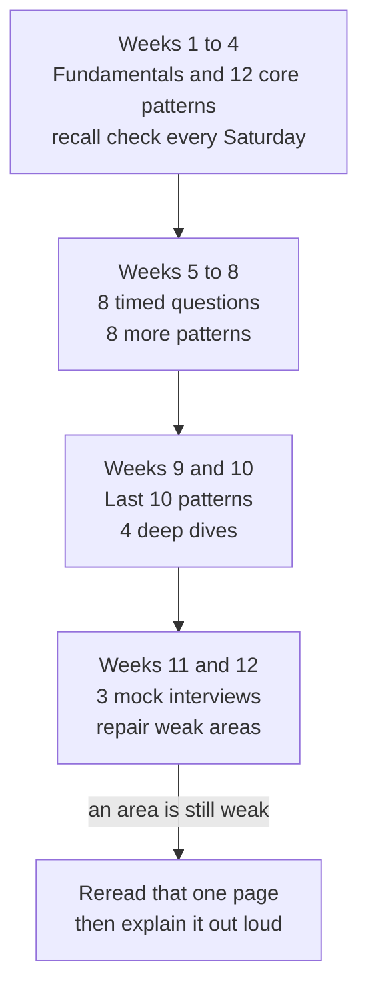

# 3-month study plan

> This 12-week plan takes 30 to 45 minutes a day and covers all 30 patterns, 8 timed questions, 4 deep dives, and 3 mock interviews.

This plan is for two kinds of reader. The first has never studied system design. The second works full time and can give only 30 to 45 minutes a day. It assumes six study days and one rest day each week, for 12 weeks.

It is not the [6-week plan](6-week-plan.md) spread over more weeks. That plan assumes a baseline and about one hour a day, and it reads all 19 deep dives. This plan reads one or two pages per day, tests recall in six of its weeks, and reads only 4 deep dives. If your interview is closer than 12 weeks, use the [2-week sprint](2-week-plan.md) or the [1-week crash plan](1-week-plan.md).

## The weekly rhythm

Every week has reading days, practice days, and one rest day. Weeks 9 to 12 have their own tables below.

| Day | Weeks 1 to 4 | Weeks 5 to 8 |
|-----|--------------|--------------|
| Monday | Read one page | Read one pattern |
| Tuesday | Read one page | Timed question A |
| Wednesday | Explain Monday and Tuesday out loud | Compare A with its walkthrough |
| Thursday | Read one page | Read one pattern |
| Friday | Read one page | Timed question B |
| Saturday | Recall check | Compare B with its walkthrough |
| Sunday | Rest | Rest |

A **recall check** is a short test with every page closed. Take a blank page and give each topic of the week two minutes. Say what it solves, one trade-off it carries, and one case where you would not use it.

**Practice** always means the same thing in this plan: a 45-minute timer, a blank page, and talking out loud. Open the walkthrough only after the timer stops.

## Weeks 1 to 4: fundamentals and core patterns

A pattern is a reusable building block, such as a cache or a load balancer. These four weeks cover the 12 patterns that appear in most answers.

| Week | Monday, Tuesday, Thursday, Friday | Saturday recall check |
|------|-----------------------------------|-----------------------|
| 1 | [Interview framework](../cheat-sheets/interview-framework.md), [core components](../cheat-sheets/core-components.md), [estimation](../cheat-sheets/estimation.md) with [latency numbers](../cheat-sheets/latency-numbers.md), [non-functional requirements](../cheat-sheets/non-functional-requirements.md) | The seven framework steps and their minutes |
| 2 | [Load balancing](../patterns/load-balancing.md), [proxies](../patterns/proxies.md), [caching](../patterns/caching.md), [CDN](../patterns/cdn.md) | The path of one request, from client to database |
| 3 | [Replication](../patterns/replication.md), [sharding and partitioning](../patterns/sharding-partitioning.md), [consistent hashing](../patterns/consistent-hashing.md), [database indexing](../patterns/database-indexing.md) | The four patterns of this week, then read [SQL vs NoSQL](../cheat-sheets/sql-vs-nosql.md) |
| 4 | [Consistency models](../patterns/consistency-models.md), [CAP theorem](../patterns/cap-theorem.md), [message queues](../patterns/message-queues.md), [rate limiting](../patterns/rate-limiting.md) | All 12 patterns, then read [Design TinyURL](../questions/design-tinyurl.md) once |

Keep the [glossary](../glossary.md) open during these weeks.

**You are done with weeks 1 to 4 when** you can explain each of the 12 patterns in two minutes with the page closed, and state the seven framework steps with their time budget.

## Weeks 5 to 8: eight timed questions

Each reading day covers a pattern that is relevant to the question of the next day. When the walkthrough does not name it, ask where it would fit in your design.

| Week | Monday pattern | Tuesday question | Thursday pattern | Friday question |
|------|----------------|------------------|------------------|-----------------|
| 5 | [API gateway](../patterns/api-gateway.md) | [Rate limiter](../questions/design-rate-limiter.md) | [Bloom filters](../patterns/bloom-filters.md) | [Web crawler](../questions/design-web-crawler.md) |
| 6 | [Long polling, WebSockets, and SSE](../patterns/long-polling-websockets-sse.md) | [WhatsApp](../questions/design-whatsapp.md) | [Backpressure](../patterns/backpressure.md) | [Twitter](../questions/design-twitter.md) |
| 7 | [Idempotency](../patterns/idempotency.md) | [Payment system](../questions/design-payment-system.md) | [Distributed locking](../patterns/distributed-locking.md) | [Ticketmaster](../questions/design-ticketmaster.md) |
| 8 | [Circuit breaker](../patterns/circuit-breaker.md) | [Uber](../questions/design-uber.md) | [Outbox pattern](../patterns/outbox-pattern.md) | [Notification system](../questions/design-notification-system.md) |

On each comparison day, write down three things the walkthrough did that you did not. Keep these notes in one file, because weeks 11 and 12 use them.

**You are done with weeks 5 to 8 when** you can take any of the eight questions from a blank page to a design you can defend in 45 minutes.

## Weeks 9 and 10: the last patterns and four deep dives

A deep dive is a page that explains how one real system works. These two weeks change the rhythm: Monday to Wednesday are patterns, Thursday and Friday are deep dives, and Saturday is a recall check.

| Week | Monday | Tuesday | Wednesday | Thursday | Friday |
|------|--------|---------|-----------|----------|--------|
| 9 | [Quorum](../patterns/quorum.md), [leader election](../patterns/leader-election.md) | [Heartbeats](../patterns/heartbeats.md), [gossip protocol](../patterns/gossip-protocol.md) | [Write-ahead log](../patterns/write-ahead-log.md) | [Dynamo](../deep-dives/dynamo-key-value-store.md) | [Raft](../deep-dives/raft-consensus.md) |
| 10 | [Checksums](../patterns/checksums.md), [logical clocks](../patterns/logical-clocks.md) | [Distributed transactions](../patterns/distributed-transactions.md), [event sourcing and CQRS](../patterns/event-sourcing-cqrs.md) | [Batch vs stream processing](../patterns/batch-vs-stream-processing.md) | [Kafka](../deep-dives/kafka-distributed-messaging.md) | [Spanner](../deep-dives/spanner-global-sql.md) |

The four deep dives were selected because each one uses patterns you have just read. Dynamo uses quorum and gossip, and Raft uses leader election, heartbeats, and a log. Kafka is a log that supports stream processing and event sourcing. Spanner uses distributed transactions and orders them with synchronized physical clocks.

**You are done with weeks 9 and 10 when** you can name the one idea each of the four systems is known for, and say which patterns it combines.

## Weeks 11 and 12: mocks and repair

A mock interview is a practice interview run under real conditions, on a question you have not seen.

| Week | Monday | Tuesday | Wednesday | Thursday | Friday | Saturday |
|------|--------|---------|-----------|----------|--------|----------|
| 11 | Read the [annotated mock interview](../cheat-sheets/mock-interview-walkthrough.md) | Mock 1: [Dropbox](../questions/design-dropbox.md) | Score it against [common mistakes](../cheat-sheets/common-mistakes.md) | Repair your weakest area | Mock 2: [YouTube](../questions/design-youtube.md) | [Flashcards](../cheat-sheets/flashcards.md) |
| 12 | Repair your second weakest area | Mock 3 with another person: [mock interviews](https://www.designgurus.io/mock-interviews?utm_source=github&utm_medium=repo&utm_campaign=grokking-system-design&utm_content=roadmaps-3-month-plan) | Read [communication tips](../cheat-sheets/communication-tips.md) | Read your company page in the [company index](../companies/README.md) | Repeat your weakest question from weeks 5 to 8 | [System design in one page](../cheat-sheets/system-design-in-one-page.md) |

To repair an area, reread its one page and then explain it out loud. Your notes from weeks 5 to 8 tell you which areas to choose.

**You are done with weeks 11 and 12 when** you can begin a question you have never seen and know what your first five minutes contain.

## When you miss a week

Do not try to complete two weeks in one. Doubling the daily time usually ends the plan.

- **One missed day.** Skip the page and continue. Add it to the next Saturday recall check.
- **One missed week, with a flexible date.** Move the whole calendar forward by one week.
- **One missed week, with a fixed date.** Remove the four deep dive days. Then merge weeks 9 and 10: two patterns a day from Monday to Friday, then one recall check.

Never remove the recall checks or the three mocks. Reading without testing produces very little that you can use in the interview.

## What this plan covers and leaves out

| Material | Covered | Left out |
|----------|---------|----------|
| [Patterns](../patterns/README.md) | All 30 | None |
| [Questions](../questions/README.md) | 8 timed, 1 read, 2 as mocks | Most of the catalog |
| [Deep dives](../deep-dives/README.md) | 4 of 19 | The other 15 |

The other 15 deep dives matter most for senior and staff roles. If that is your target, add three weeks at five deep dives a week, and follow the reading order in the deep dive index.

## Tips

- Study at the same hour every day.
- Stop at 45 minutes, because a short session repeated for 12 weeks is better than a long one you abandon.
- Use the [practice bank](../questions/practice-bank.md) when you want more questions after week 8.

## Go deeper

- Start with the free lesson [Introduction to System Design](https://www.designgurus.io/course-play/grokking-system-design-fundamentals/doc/introduction-to-system-design?utm_source=github&utm_medium=repo&utm_campaign=grokking-system-design&utm_content=roadmaps-3-month-plan) in [Grokking System Design Fundamentals](https://www.designgurus.io/course/grokking-system-design-fundamentals?utm_source=github&utm_medium=repo&utm_campaign=grokking-system-design&utm_content=roadmaps-3-month-plan), the beginner course that matches weeks 1 to 4.
- Full course for weeks 5 to 8: [Grokking the System Design Interview](https://www.designgurus.io/course/grokking-the-system-design-interview?utm_source=github&utm_medium=repo&utm_campaign=grokking-system-design&utm_content=roadmaps-3-month-plan)
- Practice live: [mock interviews](https://www.designgurus.io/mock-interviews?utm_source=github&utm_medium=repo&utm_campaign=grokking-system-design&utm_content=roadmaps-3-month-plan)
