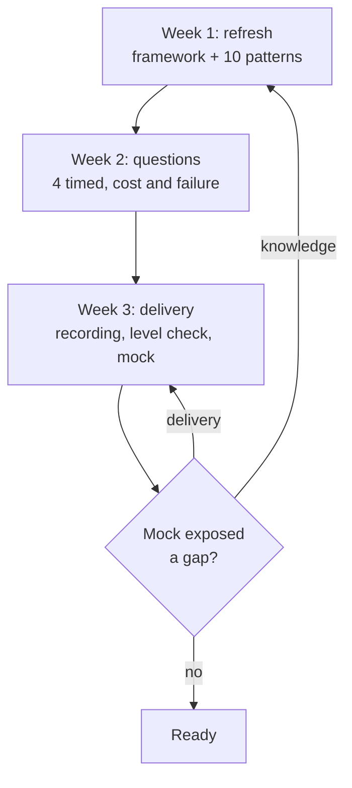

# Engineering manager plan

> A three-week plan at about one hour a day for engineering managers and tech leads who face a system design round in a management loop.

This plan is for engineering managers and tech leads who have not designed a system directly for some time. It assumes about 1 hour a day for 21 days. If you have never taken a system design round, start with the [6-week study plan](6-week-plan.md). If you are interviewing for a senior or staff engineering role, use the [senior and staff refresher](senior-staff-refresher.md).

## How the round tends to differ for managers

The details vary by company and by level. Treat the points below as tendencies, and confirm the format with your recruiter.

- **Breadth over implementation detail.** A manager is often expected to produce a complete, reasonable design, and is less often asked to explain the internals of one storage engine.
- **Trade-offs stated with cost and risk.** A trade-off is a choice in which you gain one property and give up another. A manager is usually expected to add what each option costs to run and what can go wrong.
- **Operational concerns.** Expect questions about rollout, which is how a change reaches users in stages. Expect monitoring questions too, and questions about on-call, which is the rotation of engineers who respond to alerts.
- **Leading the conversation.** You set the agenda, manage the 45 minutes, and decide which part to examine in detail.
- **Handling disagreement.** The interviewer may challenge a decision to observe how you respond. State your reasoning, ask what constraint they have in mind, and change the design if their point is valid.

## Week 1: the framework and ten patterns

A pattern is a reusable solution to a problem that many systems share. The repo has 30 patterns, and this plan selects 10. Study each one at the level of a design review, not an implementation. For each pattern, write three lines: what it solves, what it costs, and when not to use it.

| Day | Focus |
|-----|-------|
| 1 | The [interview framework](../cheat-sheets/interview-framework.md) and [non-functional requirements](../cheat-sheets/non-functional-requirements.md) |
| 2 | [Caching](../patterns/caching.md) and [load balancing](../patterns/load-balancing.md) |
| 3 | [Replication](../patterns/replication.md) and [sharding and partitioning](../patterns/sharding-partitioning.md) |
| 4 | [Consistency models](../patterns/consistency-models.md) and [message queues](../patterns/message-queues.md) |
| 5 | [Idempotency](../patterns/idempotency.md) and [rate limiting](../patterns/rate-limiting.md) |
| 6 | [Circuit breaker](../patterns/circuit-breaker.md) and [backpressure](../patterns/backpressure.md) |
| 7 | [Trade-offs](../cheat-sheets/trade-offs.md), then explain all ten patterns out loud without notes, 2 minutes each |

The last four patterns concern failure and overload. Idempotency means that repeating a request has the same effect as sending it once. Rate limiting caps the number of requests that one client may send in a period. A circuit breaker stops calls to a failing service for a short period. Backpressure is a signal from a slow service that tells its callers to send less.

**You are done with week 1 when** you can give the three lines for all ten patterns with every page closed, and can name the seven steps of the framework in order.

## Week 2: four questions

Each practice session uses a 45-minute timer, a blank page, and talking out loud. Use the remaining 15 minutes to compare your answer with the walkthrough. In every answer, give time to four things: requirements, estimation, cost, and failure handling.

| Day | Focus |
|-----|-------|
| 8 | [Estimation](../cheat-sheets/estimation.md) and [latency numbers](../cheat-sheets/latency-numbers.md), then produce only the numbers for two questions from the [catalog](../questions/README.md) |
| 9 | [Design a payment system](../questions/design-payment-system.md): failure handling and duplicate requests |
| 10 | [Design a metrics and monitoring system](../questions/design-metrics-monitoring.md): the system behind your own alerts |
| 11 | [Design a code deployment system](../questions/design-code-deployment-system.md): staged rollout and rollback |
| 12 | [Design a flash sale system](../questions/design-flash-sale-system.md): a load peak and limited stock |
| 13 | Repeat the weakest of the four, and state the monthly cost of its largest part |
| 14 | For each of the four designs, write the five rows of the table below |

These four were selected because each one leads to an operational discussion: money that must not be lost, alerts, releases, and overload.

**You are done with week 2 when** every answer contains a number that changed a decision, a named failure with its handling, and one sentence about cost.

## What to prepare beyond the design

Prepare a short answer on each of these topics for every question you practice. The interviewer may never ask, but raising one or two yourself shows judgment.

| Topic | What to be ready to say | Useful page |
|-------|-------------------------|-------------|
| Rollout plan | Which users receive the change first, what you measure at each stage, and how you reverse it | [Code deployment system](../questions/design-code-deployment-system.md) |
| Monitoring | The three or four measurements that show the system is healthy, and which of them alerts a person | [Metrics and monitoring](../questions/design-metrics-monitoring.md) |
| Team split | Which parts separate teams can own, and the interface between them | [API gateway](../patterns/api-gateway.md) |
| Build versus buy | Which parts you would take as a managed service, and the one part worth building yourself | [AWS vs GCP vs Azure](../cheat-sheets/aws-vs-gcp-vs-azure.md) |
| Cost | The largest cost in the design (storage, compute, or network) and one way to reduce it | [Estimation](../cheat-sheets/estimation.md) |

## Week 3: self-review, level check, and a live mock

| Day | Focus |
|-----|-------|
| 15 | Record a full answer to an unseen question, such as [design a hotel reservation system](../questions/design-hotel-reservation.md) |
| 16 | Listen to the recording with [communication tips](../cheat-sheets/communication-tips.md) open, and note each decision you made without stating a reason |
| 17 | [Senior vs staff expectations](../cheat-sheets/senior-vs-staff-expectations.md): mark the behaviors missing from your recording |
| 18 | The [annotated mock interview](../cheat-sheets/mock-interview-walkthrough.md), then practice answering three challenges to your own design |
| 19 | A live mock with a peer or a [mock interview](https://www.designgurus.io/mock-interviews?utm_source=github&utm_medium=repo&utm_campaign=grokking-system-design&utm_content=roadmaps-engineering-manager-plan) |
| 20 | Repeat the mock question alone and correct the two largest problems |
| 21 | [Common mistakes](../cheat-sheets/common-mistakes.md) and the [one-page summary](../cheat-sheets/system-design-in-one-page.md), then stop |

In a management loop, this round is often scored against the standard for a senior or staff engineer, which is why day 17 uses that sheet.

**You are done with week 3 when** you have completed one recorded answer and one live mock, and the second contained fewer unexplained decisions than the first.

## What this plan covers and leaves out

The plan covers 10 of the 30 patterns and none of the 19 deep dives. It also covers four practiced questions, one recorded question, and one live mock. It leaves out the coordination patterns, such as [leader election](../patterns/leader-election.md), [quorum](../patterns/quorum.md), and [distributed transactions](../patterns/distributed-transactions.md). It also leaves out real-time, geographic, and machine learning questions. If your role is in one of those areas, replace one question in week 2 with a matching one from the [question catalog](../questions/README.md).

## Tips

- Do not answer from your current system. The interviewer does not know its constraints, so derive each decision from the stated requirements.
- When you do not know a detail, say so and state how you would find out. Guessing with confidence is the larger risk.
- Give cost as a rough number. "About 2 terabytes a month, which is inexpensive in object storage" is enough.
- Delegation is not an answer in this round. "My team would decide that" should become "I would choose X, because Y".

## Go deeper

- Related pages: [all roadmaps](README.md), [senior vs staff expectations](../cheat-sheets/senior-vs-staff-expectations.md), [non-functional requirements](../cheat-sheets/non-functional-requirements.md)
- Full course: [Grokking the System Design Interview](https://www.designgurus.io/course/grokking-the-system-design-interview?utm_source=github&utm_medium=repo&utm_campaign=grokking-system-design&utm_content=roadmaps-engineering-manager-plan)
- For senior-level depth: [Advanced System Design Interview, Volume II](https://www.designgurus.io/course/grokking-system-design-interview-ii?utm_source=github&utm_medium=repo&utm_campaign=grokking-system-design&utm_content=roadmaps-engineering-manager-plan)
- Practice live: [mock interviews](https://www.designgurus.io/mock-interviews?utm_source=github&utm_medium=repo&utm_campaign=grokking-system-design&utm_content=roadmaps-engineering-manager-plan)
