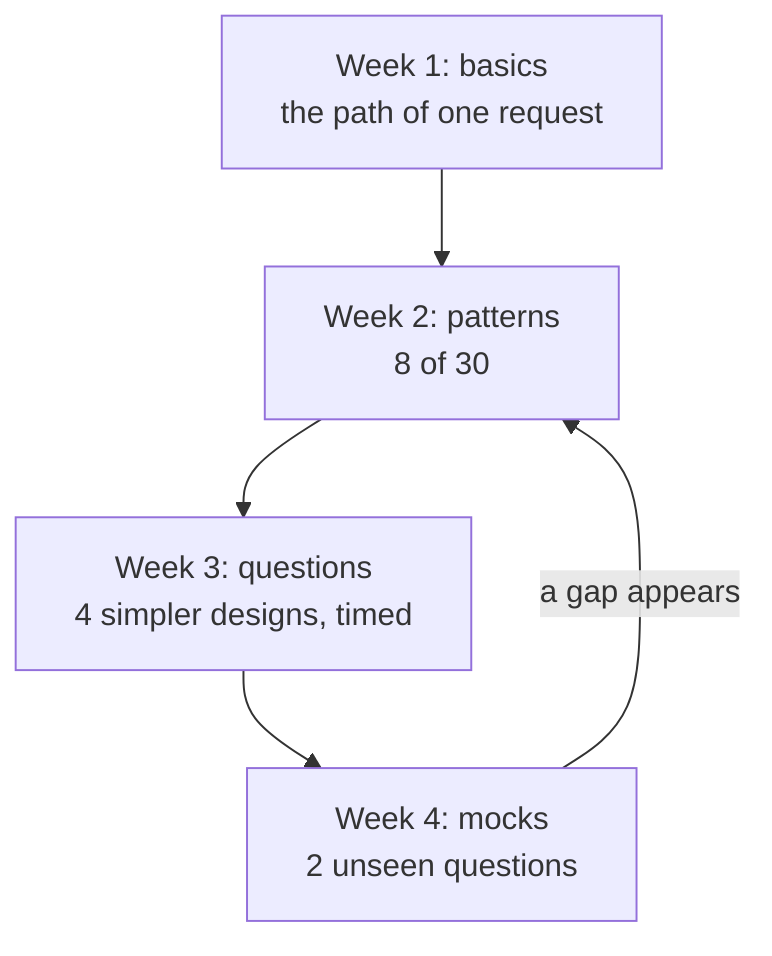

# New grad and junior plan

> A four-week plan at about 45 minutes a day for students, new graduates and junior engineers who face an entry-level system design round.

This plan is for students, new graduates, and engineers with under two years of experience. It assumes about 45 minutes a day for 28 days. It also assumes that you have written code but have never operated a system that serves real traffic. If you have already run production systems, the [2-week sprint](2-week-plan.md) or the [6-week study plan](6-week-plan.md) will suit you better.

## How the entry-level round differs

The entry-level round usually has a smaller scope than the senior one. You are more likely to design one service with a few operations than a product that spans several regions. The interviewer also tends to guide more: they suggest a direction, ask a narrower follow-up question, or correct a wrong assumption so that you can continue.

Because of this, fundamentals and clear reasoning matter more than scale techniques. A simple design that you can explain and defend, with a stated reason for each part, is a stronger answer than a large design copied from memory. You are generally not expected to know how a consensus algorithm works, but you are expected to know why a system has a database and when a cache helps.

## Week 1: the basics

Week 1 follows one request from the browser to the database and back. Three parts appear in almost every design, so learn them first. A load balancer is a server that spreads incoming requests across several application servers. A cache is a fast store that keeps copies of frequently read data, usually in memory. A database is the store that keeps the data permanently.

| Day | Focus |
|-----|-------|
| 1 | The client, the server, and the path of one request in [core components](../cheat-sheets/core-components.md). Look up each unknown word in the [glossary](../glossary.md). |
| 2 | The whole subject on [one page](../cheat-sheets/system-design-in-one-page.md), read twice |
| 3 | Databases: [SQL vs NoSQL](../cheat-sheets/sql-vs-nosql.md) |
| 4 | Caches: [caching strategies](../cheat-sheets/caching-strategies.md) |
| 5 | Load balancers: [layer 4 vs layer 7 load balancing](../cheat-sheets/l4-vs-l7-load-balancing.md) |
| 6 | The [interview framework](../cheat-sheets/interview-framework.md) and [non-functional requirements](../cheat-sheets/non-functional-requirements.md) |
| 7 | [Estimation](../cheat-sheets/estimation.md), then draw the path of one request on a blank page without notes |

**You are done with week 1 when** you can draw a client, a load balancer, two application servers, a cache, and a database from memory. You must also be able to say in one sentence what each of the five parts does.

## Week 2: eight core patterns

A pattern is a reusable solution to a problem that many systems share. The repo has 30 patterns, and this plan covers the 8 that simple designs use most often. For each one, write three sentences: what it solves, what it costs, and when you would not use it.

| Day | Focus |
|-----|-------|
| 8 | [Caching](../patterns/caching.md) |
| 9 | [Load balancing](../patterns/load-balancing.md) |
| 10 | [Database indexing](../patterns/database-indexing.md) |
| 11 | [Replication](../patterns/replication.md) |
| 12 | [Sharding and partitioning](../patterns/sharding-partitioning.md) |
| 13 | [Message queues](../patterns/message-queues.md) and [rate limiting](../patterns/rate-limiting.md) |
| 14 | [CDN](../patterns/cdn.md), then explain all eight patterns out loud, 2 minutes each |

**You are done with week 2 when** you can give those three sentences for all eight patterns with every page closed.

## Week 3: four simpler questions

The first three questions take two days each. On the first day you practice: set a 45-minute timer, start with a blank page, and talk out loud for the whole time. On the second day you read the walkthrough and write down every difference between it and your answer. The fourth question is attempted on day 21 and compared on day 22.

| Days | Focus |
|------|-------|
| 15 and 16 | [Design TinyURL](../questions/design-tinyurl.md): storage, key generation, and a read-heavy workload |
| 17 and 18 | [Design a rate limiter](../questions/design-rate-limiter.md), with [rate limiting algorithms](../cheat-sheets/rate-limiting-algorithms.md) open on the second day |
| 19 and 20 | [Design a unique ID generator](../questions/design-unique-id-generator.md): several servers that must never produce the same ID |
| 21 | [Design a notification system](../questions/design-notification-system.md), timed attempt only |

These four were selected because each one is a single service with a small set of operations. None of them requires real-time messaging, location data, or video, which belong to later study.

**You are done with week 3 when** you can spend the first 5 minutes of a question on requirements without being reminded. Your written list of differences should also be shorter for the third question than for the first.

## Week 4: mocks

A mock is a practice interview on a question you have not seen before. Take the two mock questions from the [practice bank](../questions/practice-bank.md) or the [question catalog](../questions/README.md).

| Day | Focus |
|-----|-------|
| 22 | Compare the notification system answer from day 21 with the walkthrough, then read [common mistakes](../cheat-sheets/common-mistakes.md) |
| 23 | [Communication tips](../cheat-sheets/communication-tips.md) and the [annotated mock interview](../cheat-sheets/mock-interview-walkthrough.md) |
| 24 | Mock 1: an unseen question such as [design a gaming leaderboard](../questions/design-gaming-leaderboard.md), recorded |
| 25 | Listen to the recording, then use the [flashcards](../cheat-sheets/flashcards.md) for every term you could not explain |
| 26 | Mock 2 with another person: a friend, a classmate, or a [mock interview](https://www.designgurus.io/mock-interviews?utm_source=github&utm_medium=repo&utm_campaign=grokking-system-design&utm_content=roadmaps-new-grad-plan) |
| 27 | Repeat the weakest of the four questions from week 3 |
| 28 | Read [trade-offs](../cheat-sheets/trade-offs.md) and the [one-page summary](../cheat-sheets/system-design-in-one-page.md), then stop |

**You are done with week 4 when** you have finished two full 45-minute answers on unseen questions without stopping to consult a page.

## Mistakes specific to junior candidates

- **Adding technology without a reason.** Naming a message queue, three databases, and a search engine does not show knowledge. Add a part only after you have stated the problem it solves in this design.
- **Skipping requirements.** Many junior candidates start drawing in the first minute. Ask what the system must do, how many users it has, and whether reads or writes are more frequent.
- **Silence.** The interviewer can evaluate only what you say. If you need time to think, say what you are deciding between.
- **Treating a hint as a failure.** A hint is normal in this round. Accept it, say how it changes the design, and continue.
- **Reciting a memorized answer.** A follow-up question will reveal it within a minute. Explain your own simpler design instead.
- **Designing for a billion users when the question states ten thousand.** Match the design to the stated numbers, and say what you would change if they grew.

## What this plan covers and leaves out

The plan covers 8 of the 30 patterns and none of the 19 deep dives. It also covers four practiced questions and two mock questions. The 22 remaining patterns include [consistency models](../patterns/consistency-models.md), the [CAP theorem](../patterns/cap-theorem.md), and [consistent hashing](../patterns/consistent-hashing.md), which are the usual next step. If a mock leads you to one of them, read that single page and then return to the plan.

## Tips

- Keep one notebook page of terms you could not define, and check each one in the [glossary](../glossary.md).
- Say numbers, even rough ones. "About 100 requests per second" is more useful than "a lot of traffic".
- When the four weeks are over, continue with the patterns and questions in the [6-week study plan](6-week-plan.md) that this plan did not cover.

## Go deeper

- Related pages: [all roadmaps](README.md), [interview framework](../cheat-sheets/interview-framework.md), [common mistakes](../cheat-sheets/common-mistakes.md)
- Start with the free lesson [What is a System Design Interview?](https://www.designgurus.io/course-play/grokking-the-system-design-interview/doc/what-is-a-system-design-interview?utm_source=github&utm_medium=repo&utm_campaign=grokking-system-design&utm_content=roadmaps-new-grad-plan) in [Grokking the System Design Interview](https://www.designgurus.io/course/grokking-the-system-design-interview?utm_source=github&utm_medium=repo&utm_campaign=grokking-system-design&utm_content=roadmaps-new-grad-plan).
- Beginner course: [Grokking System Design Fundamentals](https://www.designgurus.io/course/grokking-system-design-fundamentals?utm_source=github&utm_medium=repo&utm_campaign=grokking-system-design&utm_content=roadmaps-new-grad-plan)
- Practice live: [mock interviews](https://www.designgurus.io/mock-interviews?utm_source=github&utm_medium=repo&utm_campaign=grokking-system-design&utm_content=roadmaps-new-grad-plan)
